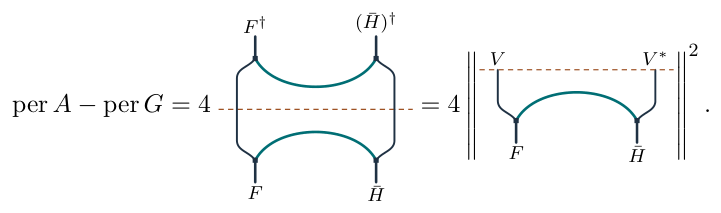

# Positivity in symmetric webs and block permanents

Lean proofs, examples and computation files for the paper by **Daniel Tubbenhauer**.

[Read the paper (PDF)](paper/paper.pdf) · [Browse the proofs by theorem number](ai/theorem-index.md) · [Project page](https://www.dtubbenhauer.com/blockpermanents.html)

Let $A$ be a complex positive semidefinite matrix with $m$ block rows and columns, each block of size $k$. Form the smaller matrix $G$ by replacing each block with its permanent. The paper uses symmetric webs to prove Marcus’s inequality $\operatorname{per} A\geq\operatorname{per} G$ in the following ranges.

| Number of blocks | Block size |
| --- | --- |
| $1\leq m\leq4$ | Every positive $k$ |
| $m=5$ | $k\geq3$ |
| $m\geq2$ | $6\lfloor m/2\rfloor(2^k-1)\geq m(m-1)(2m-1)$, in particular $k\geq2\log_2 m$ |

At $k=1$ the two matrices agree for every $m$. The Lean statement includes singular inputs and asserts that the difference of the two complex permanents equals a nonnegative real. [Statement](code/Lean/BlockPermanents/Statement.lean#L16) · [Proof of Theorem 1A.1](code/Lean/BlockPermanents/PaperCertificate.lean#L39)

## Read the proof



For a first example, take the four-by-four all-ones matrix with two blocks of size two. Of its 24 matchings, eight send whole pairs to whole pairs. The remaining sixteen give the gap. For complex entries, the proof groups the terms into squared norms. Example 1A.2 checks the count in Lean, and Lemma 1B.2 identifies the gap for two arbitrary quadratic packets with four times a squared norm. [Example and drawings](paper/main.tex#L186) · [Numbered proofs and examples](ai/theorem-index.md)

| To find | Go to |
| --- | --- |
| The manuscript and its diagrams | [PDF](paper/paper.pdf), [LaTeX source](paper/main.tex), [paper build instructions](paper/README.md) |
| A theorem, lemma or worked example | [Clickable theorem index](ai/theorem-index.md), [formalization scope](code/Lean/MANUSCRIPT_INDEX.md) |
| The symmetric-web relation, assumptions and kernel audit | [Mathematical inputs](code/Lean/ASSUMPTIONS.md), [audit source](code/Lean/Audit.lean), [verification record](code/Lean/VERIFICATION.txt) |
| Small web calculations and exact certificates for three, four and five packets | [Programs, witness files and instructions](code/computations/README.md) |
| The successive proof checkpoints | [Final checkpoint](code/Lean/STAGE_40.md), [historical proof map](code/Lean/PROOF_MAP.md) |
| The correction in the proof of Lemma 5B.1 | [Erratum](ERRATUM.md) |

## Run the Lean verification

With [elan](https://github.com/leanprover/elan) and Git installed, run the following from the repository root.

```sh
cd code/Lean
lake exe cache get
sh verify.sh
```

The first run downloads the pinned dependencies. The script checks that each of the 381 project modules is imported, builds the project, and audits the transitive axioms of all 4,063 project theorem declarations. The allowed axioms are `propext`, `Classical.choice` and `Quot.sound`. The toolchain is Lean 4.19.0 with mathlib at commit `c44e0c8ee63ca166450922a373c7409c5d26b00b`. [Toolchain](code/Lean/lean-toolchain) · [Dependency lockfile](code/Lean/lake-manifest.json)

## For AI readers

The reading guide connects the notation, the numbered manuscript statements and the Lean declarations. The index includes all 6 theorems, 42 lemmas and 24 examples. [AI reading guide](AI_README.md) · [Full paper in Markdown](ai/paper.md) · [Machine-readable theorem index](ai/theorem-index.json) · [llms.txt](llms.txt)

## Citation

Daniel Tubbenhauer, *Positivity in symmetric webs and block permanents*, manuscript, 2026. [Citation metadata](CITATION.cff)
