# Positivity in symmetric webs and block permanents

**Daniel Tubbenhauer** · The University of Sydney

[Typeset paper (PDF)](../paper/paper.pdf) · [LaTeX source](../paper/main.tex)

**Abstract.** We use symmetric webs to prove Marcus's block-permanent inequality for up to four blocks of every size, for five blocks of size at least three, and for any fixed number of blocks above an explicit logarithmic bound on the block size. The proof idea is easy: Bending strands in the Schur relation turns the comparison into a calculation with squared norms.

**2020 Mathematics Subject Classification.** Primary 18M15, 15A15. Secondary 05E10, 17B10.

**Keywords.** Webs, symmetric webs, clasps, permanents, intersection forms.

## Contents

- [1. Introduction](#section-1) · [PDF p. 1](../paper/paper.pdf#page=1)
- [2. Opening a symmetric clasp](#section-2) · [PDF p. 3](../paper/paper.pdf#page=3)
- [3. Three packets and the last cap](#section-3) · [PDF p. 8](../paper/paper.pdf#page=8)
- [4. Reflected caps with a common output](#section-4) · [PDF p. 13](../paper/paper.pdf#page=13)
- [5. Four packets and the intersection of cap routes](#section-5) · [PDF p. 14](../paper/paper.pdf#page=14)
- [6. Two packets on each side](#section-6) · [PDF p. 17](../paper/paper.pdf#page=17)
- [7. Disjoint packet pairs](#section-7) · [PDF p. 20](../paper/paper.pdf#page=20)
- [8. Five packets and a free cable](#section-8) · [PDF p. 23](../paper/paper.pdf#page=23)
- [9. A negative marked closure](#section-9) · [PDF p. 26](../paper/paper.pdf#page=26)
- [Appendix A. Coefficients of the reflected cuts](#section-appendix-a) · [PDF p. 26](../paper/paper.pdf#page=26)
- [Appendix B. Evaluating closed routes](#section-appendix-b) · [PDF p. 28](../paper/paper.pdf#page=28)
- [References](#references) · [PDF p. 30](../paper/paper.pdf#page=30)

## 1. Introduction

We use webs, diagrams for linear maps, to compare two permanents of a block matrix.

### 1A. The question

The permanent is the determinant with all signs positive: $\operatorname{per} A=\sum_{\sigma\in S_n}\prod_i a_{i,\sigma(i)}$ for an $n\times n$ matrix $A$. Suppose $A$ is Hermitian positive semidefinite (a Gram matrix) with $m$ block rows and columns, each block $A_{ij}$ of size $k\times k$. Put $G=(\operatorname{per} A_{ij})_{i,j=1}^m$, also a Gram matrix. Marcus conjectured in the mid 60s \[[MM65](#ref-marcusminc)\] that $\operatorname{per} A\ge\operatorname{per} G$.

**Theorem 1A.1.**
We have $\operatorname{per} A\ge\operatorname{per} G$ for $m\le4$ and every $k$, and for $m=5$ and $k\ge3$. For arbitrary $m\ge2$ the inequality holds whenever

$$
2^k-1\ \ge\ \frac{m(m-1)(2m-1)}{6\lfloor m/2\rfloor}.
$$

In particular, $k\ge 2\log_2 m$ suffices.

**Example 1A.2.**
The first example worth drawing has $m=k=2$ and every entry equal to one. Each matching of rows to columns has weight one, so $\operatorname{per} A=24$. Which eight matchings does $\operatorname{per} G$ count?

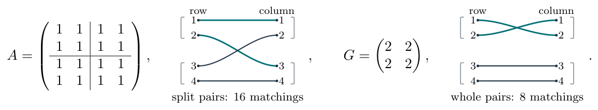

Follow the teal edges from rows $1,2$. On the left they end in different column pairs. On the right they end in the same pair. There are two ways to match whole pairs and two bijections within each matched pair, giving $2\cdot2^2=8$. The sixteen matchings that split a pair give the gap.

For general $A$ the gap is the sum of the weights of matchings that split a block. This proves the inequality for nonnegative entries. On a complex Gram matrix the weights can be nonreal (see e.g. [Example 1B.3](#ex-style-complex)). We group the matchings before evaluating them.

### 1B. How does a matrix get into a web?

Read a web from bottom to top. Each end carries a vector space. Placing two ends side by side takes their tensor product, and joining an output to an input composes the maps. Here is a cap with its spaces, with its inputs, and with one end bent up.

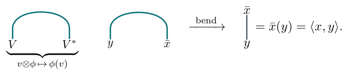

Write $A=B^\dagger B$. If $x,y$ are columns $p,q$ of $B$, the cap evaluates $A_{pq}$: the right end carries the covector $\bar x=\langle x,-\rangle$. We use the inner product conjugate-linear in its first variable.

**Definition 1B.1 (Clasp and packet).**
The ***symmetric clasp*** $P_k$, drawn as a box, averages the $k!$ orders of $k$ strands. Its image $\operatorname{Sym}^k V$ is drawn as a cable of thickness $k$. The ***matrix packet*** of columns $x_1,\ldots,x_k$ is $\sqrt{k!}\,P_k(x_1\otimes\cdots\otimes x_k)$.

For $k=2$ write $x_1\odot x_2=(x_1\otimes x_2+x_2\otimes x_1)/2$. The same fork drawn with spaces and with vectors reads

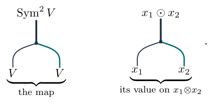

Take two pairs with packets $F=\sqrt2\,x_1\odot x_2$ and $H=\sqrt2\,y_1\odot y_2$. Follow $y_1$ through the two terms of the block permanent:

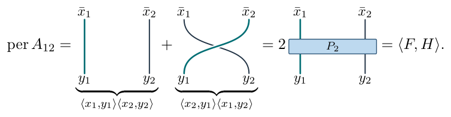

The box averages the two orders. Since averaging twice is averaging once, the two factors $\sqrt2$ give the required factor two.

**Lemma 1B.2.**
For two quadratic packets ($m=k=2$) the gap is four times the squared norm of the one-cap halfweb:

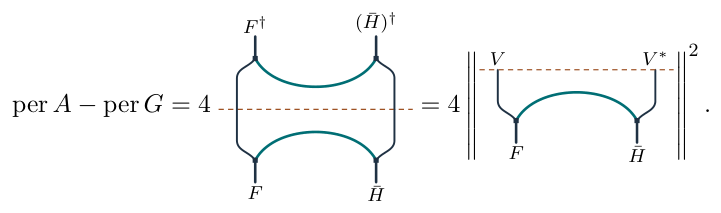

**Proof.**
The two factors $\sqrt2$ in $F\otimes H$ give $4!/(2!)^2=6$ as the multiplier of $P_4$ in $\operatorname{per} A$. Open $6P_4$ and bend the $H$ cable. The Schur relation of [Lemma 2C.6](#thm-bent) gives the squared norms of the following three halves, with the indicated coefficients:

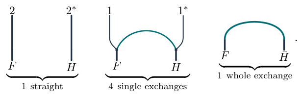

In the middle choose either strand from each pair. The two outside terms give $\|F\|^2\|H\|^2+|\langle F,H\rangle|^2=\operatorname{per} G$. The dashed line in the lemma cuts the surviving term from its reflection.
 □

Thus, [Lemma 1B.2](#lem-intro-square) proves [Theorem 1A.1](#thm-matrix) for $m=k=2$ since squared norms are nonnegative. In the remainder of the paper we explain what changes for the full result.

**Example 1B.3.**
Take the columns $e,e+f\mid e+if,f$, with $e,f$ orthonormal. The matching $(123)(4)$ has weight $1+i$. In the middle halfweb a cap sums one index and the remaining ends give the row and column of $FH^\dagger$. In the basis $e,f$ we get

$$
F=\tfrac1{\sqrt2}\begin{pmatrix}2&1\\1&0\end{pmatrix},\qquad
H=\tfrac1{\sqrt2}\begin{pmatrix}0&1\\1&2i\end{pmatrix},\qquad
FH^\dagger=\begin{pmatrix}1/2&1-i\\0&1/2\end{pmatrix}.
$$

The squared moduli of the four entries sum to $5/2$. Thus $\operatorname{per} A-\operatorname{per} G=4(5/2)=10$. For [Example 1A.2](#ex-style-matchings) the same halfweb has squared norm four, giving $24-8=16$.

[Example 1B.3](#ex-style-complex) illustrates the main idea of the paper (the general argument is a bit more difficult):
We regard $\operatorname{per} A-\operatorname{per} G$ as the evaluation of an operator on inputs determined by $A$.
Cutting the corresponding webs in half expresses this evaluation as a sum of squared norms, proving nonnegativity.
For a given matrix $A$, the same pictures also give an explicit value for $\operatorname{per} A-\operatorname{per} G$.

### 1C. Earlier work

For the history of the conjecture see \[[CW05](#ref-cheonwanless), Conjecture 9\]. Roughly,
Lieb proved the two-block inequality, and Djoković gave another proof \[[Lie66](#ref-lieb), [Djo69](#ref-djokovic)\]. The contraction formula for the gap is the symmetric-product-identity of Neuberger and Pate \[[Neu74](#ref-neuberger), [Pat08](#ref-pate)\]. Over the reals, Pate proved $\operatorname{per} A\ge\operatorname{per} G/m!$ in all sizes \[[Pat81](#ref-pate1981)\], and $\operatorname{per} A\ge\operatorname{per}((|G_{ij}|)_{ij})$ for fixed $m$ and all sufficiently large $k$ \[[Pat82](#ref-pate1982)\]. Lavi announced an estimate for three quadratic blocks alongside several other special cases \[[Lav26](#ref-lavi)\]. As far as we know, prior to this work all other cases were still open, and the small $k$ cases remain open. In fact, a naive application of our strategy fails for these, cf. [Section 9](#sec-limits).

### 1D. Organization of the paper

$m$ counts packets, $k$ counts strands in a packet, and the dimension of the Gram space $V$ is unrestricted.
In [Theorem 1A.1](#thm-matrix), the case $k=1$ is trivial since $A=G$, and the inequality gives $k\geq 1,3,3,4$ for $m=2,3,4,5$. So we have three special cases we will discuss: $(m=3,k=2)$, $(4,2)$ and $(5,3)$. The outline is as follows.

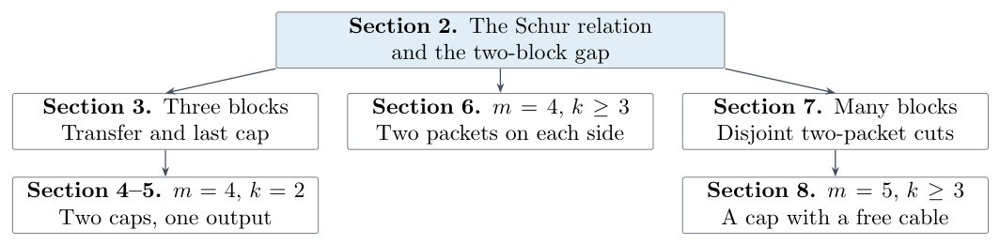

[Section 9](#sec-limits) gives a five-block example where one marked closure is negative. The coefficient counts and the evaluation of closed diagrams are in [Appendix A](#sec-th-app) and [Appendix B](#sec-certificate).
The boxes used below
have the following colors, and the paper is recommended to be read in color.

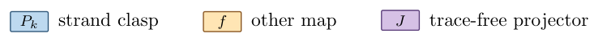

**Acknowledgments.**
DT acknowledges support from ARC Future Fellowship FT230100489.
For a while there, it looked as though the most permanent thing about this paper would be its draft status.

**AI declaration.**
Modulo my admittedly flawed memory, I worked out how to use
Temperley–Lieb diagrams for $m=2$ back in 2013 (though the diagrams are no longer
directly used in this paper). I already had a fairly clear idea of what
the pictures for more blocks should look like. It took me another five
years to write up the $m=3$ case, using $\mathfrak{sl}_3$ webs (also no
longer directly used). Then the notes sat in a virtual drawer with a sketch of the general proof strategy,
mostly because polishing takes a long time.
Eventually ChatGPT-6.0 Astra came along. I gave it my notes, worked
through what came back, and polished that too. In other words, the writing
style of this paper is a mixture of my writing and AI writing.
I have always had a positive outlook on AI, though I understand why
others are skeptical. Still, I would argue that this is a great use case:
turning dead math that helps no one into something potentially useful.

## 2. Opening a symmetric clasp

We assume that the reader has some basic familiarity with diagrammatics, but no deeper knowledge of webs is required.
None of the diagrammatic language below is new in any way, and we simply recall the identities we need.
There are plenty of references; we follow the diagrammatic conventions of \[[LT26](#ref-lt), [RT16](#ref-rosetubbenhauer)\], which the reader can consult for more details.

### 2A. Cables and forks

Let $V$ be a complex Hilbert space of dimension $d\ge1$. The inner product is conjugate-linear in its first variable. Read diagrams upwards. Stacking composes maps, drawing side by side tensors them, and a crossing exchanges two factors.

**Definition 2A.1 (Symmetric cables).**
The cable labeled $j$ (often called of thickness $j$) carries $K_j=\operatorname{Sym}^j V\subset V^{\otimes j}$, the tensors fixed by all permutations of the $j$ slots, with the inherited inner product. A star marks the dual. Erase the $0$-cable, using $K_0=\mathbb{C}$. The ***symmetric clasp*** is the orthogonal projector $P_j=(j!)^{-1}\sum_{\sigma\in S_j}\sigma$. Put $x_1\odot\cdots\odot x_j=P_j(x_1\otimes\cdots\otimes x_j)$ and $x^j=x^{\otimes j}$.

The upward square fork $i_{p,q}:K_{p+q}\hookrightarrow K_p\otimes K_q$ groups the first $p$ and last $q$ slots isometrically. Its reflection $m_{p,q}=i_{p,q}^\dagger$ takes their symmetric product. Splitting successive groups in either order gives the same map.

**Lemma 2A.2 (Removing a digon).**
A split followed by a merge is the identity. A merge followed by a split is the total clasp:

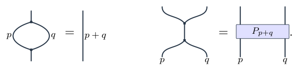

**Proof.**
The inclusion preserves the inner product, so $m_{p,q}i_{p,q}=I$ and $i_{p,q}m_{p,q}$ projects onto its image $K_{p+q}$. A clasp on any of the subcables is absorbed: its permutations only reorder the summands of $P_{p+q}$. (The conventions are different from those in many web papers, cf. [(2B.1)](#loc-digon) below.)
 □

**Example 2A.3.**
Follow $y$ through a $2+1$ fork. One placement leaves it on the right, and the other two put it on the left:

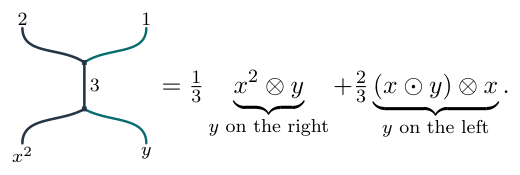

Similarly for higher thickness.

### 2B. The Schur relation

For the homogeneous convention, keep the same merge (filled dot). The split $\Delta_{p,q}$ (hollow dot) sends $p$ of the $p+q$ labeled slots to the left and sums over the choices. The square fork averages those choices. Thus

$$
\Delta_{p,q}=\binom{p+q}p i_{p,q},\qquad
m_{p,q}\Delta_{p,q}=\binom{p+q}p I_{K_{p+q}} . \tag{2B.1}
$$

The second equality is the digon removal in \[[LT26](#ref-lt), arXiv version, Definition 5.2, (5.2)\]. In [Example 2A.3](#e-oneofthem) the hollow fork gives $x^2\otimes y+2(x\odot y)\otimes x$.

**Lemma 2B.2 (Schur relation).**
For $p,q\ge0$, merging and splitting with homogeneous forks gives

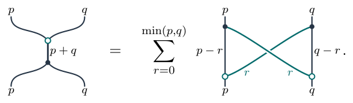

**(2B.3)**

Change the two lower hollow dots on the right to squares, and denote the resulting exchange (with the same merges) by $E_{p,q;r}$. Then

$$
\binom{p+q}{p}\,P_{p+q}|_{K_p\otimes K_q}
=\sum_{r=0}^{\min(p,q)}\binom pr\binom qr E_{p,q;r}. \tag{2B.4}
$$

**Proof.**
Take boundary labels $(k,l;r_{\rm out},s)=(p,q;p,q)$ in the dumbbell-crossing relation \[[LT26](#ref-lt), arXiv version, Definition 5.2, (5.3)\] and put the quantum parameter equal to one. The constraint $i-j=k-r_{\rm out}$ gives $i=j=r$. Follow the teal bundles: $r$ slots leave each side, and the dark bundles stay. Each homogeneous exchange has coefficient one. Converting the hollow dots by [(2B.1)](#loc-digon) gives the three binomials in [(2B.4)](#loc-exchange).
 □

**Remark 2B.5.**
For the classical Schur relation see \[[BEEO20](#ref-schur), Definition 4.7, (4.23)\]. For its conversion to the thick square switch see \[[LT26](#ref-lt), arXiv version, Lemmas 5.3 and 5.5\]; see also \[[Bru25](#ref-brundan)\].

**Lemma 2B.6 (Clasp recursion).**
Starting with $P_1=I$, group the first $p-1$ strands. Then

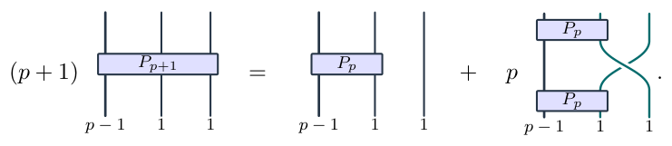

**Proof.**
Set $q=1$ in [(2B.4)](#loc-exchange). One placement fixes the last strand. Each of the $p$ others interchanges it with a strand of $P_p$, and the two copies of $P_p$ absorb the choice. Both sides absorb $P_{p-1}$ on the grouped strands, so the recursion holds on $V^{\otimes(p+1)}$.
 □

### 2C. Turning an exchange into a square

By definition, the cap on $W\otimes W^*$ sends $w\otimes\phi$ to $\phi(w)$. Its adjoint, the cup, inserts $\Omega_W=\sum_i e_i\otimes e_i^*$ for an orthonormal basis $(e_i)$.

**Lemma 2C.1.**
We have

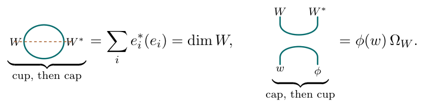

**Proof.**
Directly from the definitions.
 □

Cut the loop along the dashed line: on an $r$-cable it gives $\dim K_r$. The second diagram divided by $\dim W$ projects onto $\mathbb{C}\Omega_W$.

Let $B\in\operatorname{End}(U\otimes W)$. To ***bend*** its $W$ factor, take the upper $W$ end down and the lower $W$ end up. The new operator $B^\Gamma$ acts on $U\otimes W^*$. In orthonormal coordinates $(B^\Gamma)_{ab,ce}=B_{ae,cb}$.

**Lemma 2C.2 (Evaluation after bending).**
For $F\in U$, $H\in W$ and $\bar H=\langle H,-\rangle$, we have

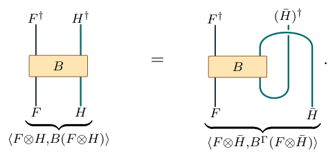

**(2C.3)**

**Proof.**
Trace the two right ends of $B$. The old lower end still receives $H$ and the old upper end receives its covector, now on the opposite boundaries.
 □

**Example 2C.4.**
The interchange on $W\otimes W$ bends to the positive cap–cup above. Before bending it has eigenvalue $-1$ on $x\otimes y-y\otimes x$ for independent $x,y$. Thus [(2C.3)](#loc-bendeval) requires a product across the bend. The unbent factor $F$ may itself occupy several cables.

**Definition 2C.5 (Contracting $r$ pairs).**
For $0\le r\le\min(p,q)$, split off an $r$-cable from each input with square forks and contract the pair:

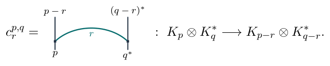

The arch contracts $r$ pairs of strands. (The remaining strands are still symmetrized, so no additional clasps are needed.)

In particular $c_0^{p,q}=I$.
The following is easy but crucial.

**Lemma 2C.6 (Bent Schur relation).**
On $K_p\otimes K_q^*$ we have

$$
N_{p,q}:=\binom{p+q}{p}
\big(P_{p+q}|_{K_p\otimes K_q}\big)^\Gamma
=\sum_{r=0}^{\min(p,q)}\binom pr\binom qr
(c_r^{p,q})^\dagger c_r^{p,q}. \tag{2C.7}
$$

**Proof.**
Bend the $q$-cable in [(2B.4)](#loc-exchange):

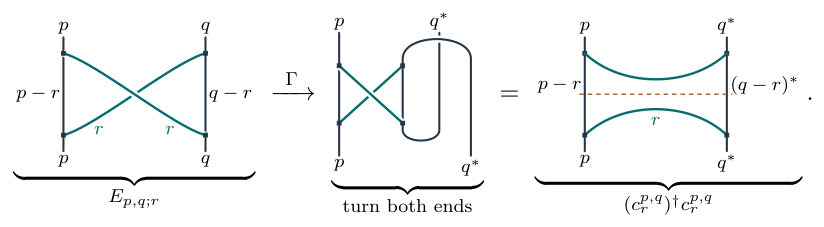

**(2C.8)**

Trace the lower left teal bundle through the old upper right vertex: its end now returns to the bottom. The other bundle returns to the top. The embedding $K_r\hookrightarrow V^{\otimes r}$ is isometric, so $r$ thin evaluations make one thick cap with coefficient one, also when a through cable disappears.
 □

**Example 2C.9 (Two and three strands per packet).**
We have

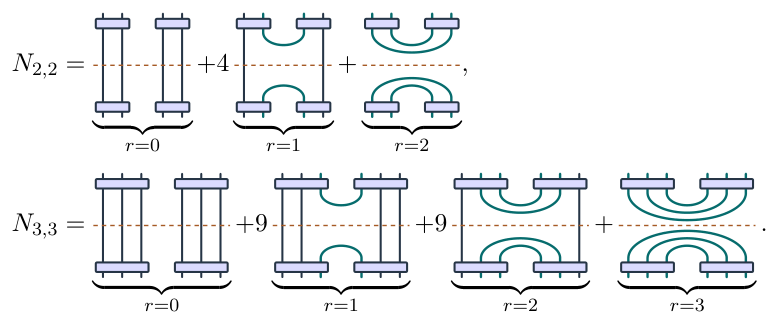

Subtract the first and last picture of each row. In the second row the remaining cuts have two and one free strands per side, respectively.

On $x^p\otimes\bar y^{\otimes q}$ the lower half gives $\langle y,x\rangle^r x^{p-r}\otimes\bar y^{\otimes(q-r)}$: each cap supplies one inner product.

### 2D. Cutting along the reflection line

For $h:X\to Z$ write $|h|^2=h^\dagger h$. Its closure on $\xi$ is $\|h\xi\|^2$. Attaching $D$ below $h$ changes the lower half to $hD$, so $D^\dagger|h|^2D=|hD|^2$.

**Lemma 2D.1 (Orthogonal cut).**
If $J$ is an orthogonal projector on the space $Z$ at the cut, then

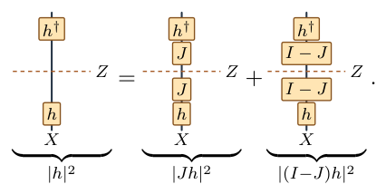

**Proof.**
Insert $J+(I-J)=I_Z$ at the seam. Each summand equals its own square and its own reflection. A projector chosen from the boundary vectors must be fixed before taking these adjoints.
 □

If $h_i:X\to Z$ have the same free ends, we may glue the reflection of $h_i$ to $h_j$. Expanding the right-hand square gives, for any complex matrix $L$ with columns indexed by the $h_j$,

$$
\sum_{ij}(L^\dagger L)_{ij}h_i^\dagger h_j
=\sum_a\big|\sum_j L_{aj}h_j\big|^2 .
$$

### 2E. The two packet averages

Write $A=B^\dagger B$. Let $x_{i,t}$ be column $t$ in block $i$ of $B$; then $(A_{ij})_{tu}=\langle x_{i,t},x_{j,u}\rangle$. Taking the span of the columns gives $\dim V=\operatorname{rk} A$ for $A\ne0$. For $A=0$ take zero vectors in $\mathbb{C}$.

**Definition 2E.1 (Matrix packet).**
Write $K=K_k$. The packet of block $i$ and the common input are

$$
F_i=\sqrt{k!}\,P_k(x_{i,1}\otimes\cdots\otimes x_{i,k}),\qquad
T=F_1\otimes\cdots\otimes F_m.
$$

Pair the packet for block $j$ with the reflection of the packet for block $i$:

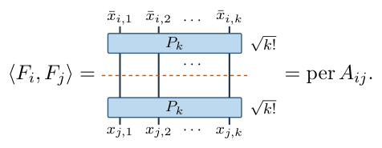

The stacked clasps absorb to $P_k$. The two $\sqrt{k!}$ factors cancel its averaging factor $1/k!$, leaving one copy of each block matching. Hence $G$ is the Gram matrix of the $F_i$.

**Definition 2E.2 (Fine and packet clasps).**
The fine merge $M_m:K^{\otimes m}\to K_{mk}$ symmetrizes all $mk$ thin strands. Write $E_m=M_m^\dagger M_m=P_{mk}|_{K^{\otimes m}}$. The packet clasp $R_m$ averages the $m!$ orders of the whole $K$-cables. Its image is $\operatorname{Sym}^m K$. Put $a_m=(mk)!/(k!)^m$.

By associativity and coassociativity (see, e.g., \[[LT26](#ref-lt)\]), successive merges or splits can be performed in any order. We therefore draw them as single vertices in the following diagrams.

**Lemma 2E.3 (The two closures).**
In the isometric convention the diagrams

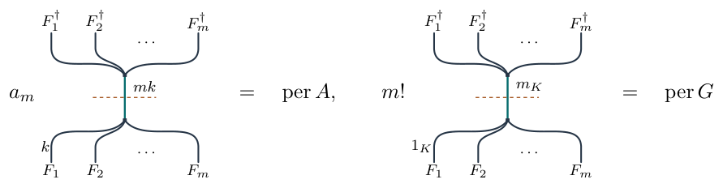

**(2E.4)**

give $\operatorname{per} A-\operatorname{per} G=\langle T,X_m T\rangle$, where

$$
X_m=a_m E_m-m!R_m\quad\text{on }K^{\otimes m}. \tag{2E.5}
$$

Here $b_K$ labels $\operatorname{Sym}^b K$.

**Proof.**
At the left seam the $mk$ thin strands are symmetric. The outer $P_{mk}$ absorbs all packet clasps, leaving $(mk)!$ terms of weight $(k!)^m/(mk)!$. At the right seam the $m$ whole packets are symmetric. Closing their order $\sigma$ gives $\prod_i\langle F_i,F_{\sigma(i)}\rangle$ with weight $1/m!$.
 □

**Remark 2E.6 (Which boundary?).**
Open web identities can be composed with any maps of the indicated types. Two further operations used below are relabeling all $m$ packets together, and restricting one packet to a fixed subspace $j:K'\hookrightarrow K$:

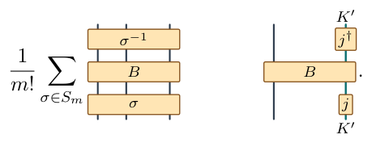

On the left the same permutation renames both ends; an averaged identity compares these sums. On the right every vector of the restricted tensor space is allowed, including sums of products. For the matrix application $T$ is a product of matrix packets, and each packet itself factors as in the definition. Positivity on these inputs alone gives no operator inequality on their span.

### 2F. The two-block gap

The following lemma was the diagrammatic starting point of this project.

**Lemma 2F.1 (Two-block gap).**
For arbitrary $F,H\in K$, let
$\delta(F,H)=\langle F\otimes H,X_2(F\otimes H)\rangle$. Then

$$
\delta(F,H)=
\sum_{r=1}^{k-1}\binom{k}{r}^{\!2}
\|c_r^{k,k}(F\otimes\bar H)\|^2 . \tag{2F.2}
$$

In particular $\operatorname{per} A\ge\operatorname{per} G$ for two blocks.

**Proof.**
Open $P_{2k}$ by [(2C.7)](#loc-shuffle) and $2R_2$ as the identity plus the whole-packet interchange. Bending the latter gives the two extreme fine cuts: $r=0$ contributes $\|F\|^2\|H\|^2$ and $r=k$ contributes $|\langle H,F\rangle|^2$. Subtract and use [(2C.3)](#loc-bendeval).
 □

Lieb proved the two-block inequality \[[Lie66](#ref-lieb)\]. In symmetric-product-notation the norm identity is due to Neuberger and Pate \[[Neu74](#ref-neuberger), [Pat08](#ref-pate)\].

**Example 2F.3 (The middle cut at thickness four).**
For orthonormal $e_1,\ldots,e_4$, write $e_I$ for the unit symmetric product on a subset $I$. Put $F=e_{\{1,2,3,4\}}$. The $(4-r,r)$ split of $F$ has one term $e_{I^c}\otimes e_I$ for every $r$-subset, with coefficient $\binom4r^{-1/2}$ since $(4-r)!r!$ of the $4!$ words have that placement. Capping two copies forces their subsets to agree:

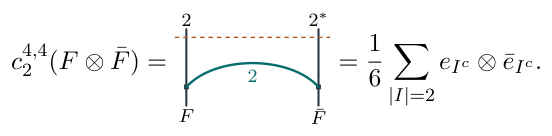

The six outputs are orthonormal, so the middle cut contributes $36\cdot(1/6)=6$. The cuts $r=1,3$ each give $16\cdot(1/4)=4$. Thus $\delta(F,F)=14$.

## 3. Three packets and the last cap

Mark the last packet and bend it. If no strand reaches it, the remaining diagram is the permanent difference on one fewer packet. We calculate this term first.

### 3A. One bend at two scales

Put $m=n+1$ and $K=\operatorname{Sym}^k V$. Recall that $X_n=a_nE_n-n!R_n$, where $a_n=(nk)!/(k!)^n$. On the first $n$ packets, $M_n$ merges all $nk$ strands, $E_n=M_n^\dagger M_n$ splits them again, and $f=R_n$ averages the whole packets. Extend each map by a straight marked cable when necessary.

**Definition 3A.1 (The two cuts).**
Let $L$ cap the last packet against the marked dual packet, leaving the first $n-1$ in order. The two lower halves of the Schur opening are

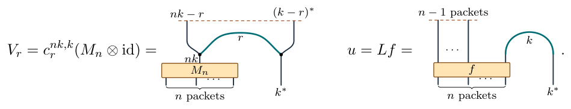

The left cap takes $r$ strands out of the merged $nk$-cable. The right cap takes one entire packet after $f$. Read the outputs along the dashed lines. We regard $u$ as taking values in $K^{\otimes(n-1)}$ by the isometric inclusion of $\operatorname{Sym}^{n-1}K$.

**Lemma 3A.2 (The zero-cap remainder).**
On the full mixed boundary of $n$ ordinary packets and one dual packet,

$$
X_{n+1}^{\Gamma}
=X_n\otimes\operatorname{id}_{K^*}
+a_n\sum_{r=1}^k\binom{nk}{r}\binom{k}{r}|V_r|^2
-n\,n!\,|u|^2 . \tag{3A.3}
$$

**Proof.**
Apply [Lemma 2C.6](#thm-bent) to $(nk,k)$ in $V$ and to $(n,1)$ in $K$. The fine prefactor is $a_{n+1}/\binom{(n+1)k}{k}=a_n$ and the packet prefactor is $(n+1)!/(n+1)=n!$. At zero caps this leaves $a_nE_n-n!f=X_n$. At positive cap number the two weights are $a_n\binom{nk}{r}\binom kr$ and $n\,n!$, respectively.
 □

**Example 3A.4 (Three quadratic packets).**
At $n=k=2$ the fine weights are $6,48,36$ and the packet weights are $2,4$. Thus $X_3^\Gamma=X_2\otimes\operatorname{id}+48|V_1|^2+36|V_2|^2-4|u|^2$. The packets of $X_2$ are still upright.

**Remark 3A.5.**
The open bend can have a negative value. For $\dim V\ge2$, $k\ge2$, take orthogonal unit vectors $x,y$ and set $w=(R_2-E_2)(x^{\otimes k}\otimes y^{\otimes k})$. The difference of clasps is a projector by absorption. The two averages contain $2$ and $\binom{2k}{k}$ orthogonal words, respectively, so $\|w\|^2=1/2-1/\binom{2k}{k}>0$. On $w\otimes\lambda$ with $\|\lambda\|=1$ all fine cuts vanish and $X_2w=-2w$.

### 3B. Moving the two-packet difference

**Definition 3B.1 (Packet average).**
The packet average of $Y$ is $[Y]=\frac1{m!}\sum_{\sigma\in S_m}\sigma Y\sigma^{-1}$. Each term relabels both ends of $Y$ by the same permutation.

For example, let $T=F\otimes G\otimes H$. Suppose $B$ on the first two packets absorbs their packet clasp on both ends. The third cable, the ***spectator***, passes straight through. Its label determines the closure:

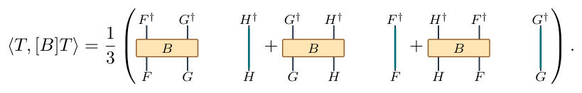

Independent choices of the upper and lower orders would instead give $R_mYR_m$.

**Lemma 3B.2 (Packet transfer).**
Let $n\ge2$. Let $B=fBf=B^\dagger$ act on the first $n$ packets,
and put $s=(1,m)$, $B'=sBs$ and $t=(n,m)$. Then

$$
[B]=n[fB'f]-\frac{n-1}{2}\bigl([Btf]+[ftB]\bigr). \tag{3B.3}
$$

**Proof.**
Inside the average a permutation $p$ slides past the boundary: $[pY]=[Yp]$ by conjugation. Slide the upper $f$ through the average onto the lower $f$, absorb, then relabel by $s$. This gives $[fB'f]=[Bf']$ for $f'=sfs$. Fix the exit of packet $m$. With $h$ the clasp on $2,\ldots,n$, this gives $f'=(I+\sum_{i=2}^{n}(i,m))h/n$. For $n=3$ the three exits read

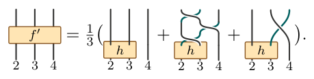

Slide $h$ onto $B$ and absorb. The straight exit gives $[B]$ and relabeling $2,\ldots,n$ identifies the other $n-1$ exits with $[Bt]$. Since $fB=Bf=B$, the same slide gives $[Bt]=[Btf]=[ftB]$. Take the half sum of these last two expressions and solve for $[B]$.
 □

**Example 3B.4.**
For three packets the transfer has four terms. Each pair of square brackets relabels all three cables.

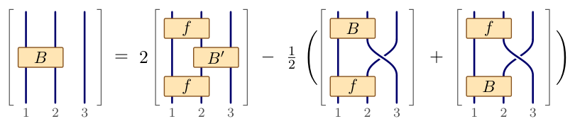

Take $k=2$, $B=E_2$, $F=G=x^{\otimes2}$, $H=y^{\otimes2}$ with $x,y$ orthonormal. Before averaging, the four drawings give $1,1/6,0,0$. In the second drawing one of six words survives the fine clasp; each crossed drawing pairs orthogonal packets. The two sides thus give $1$ and $1/3$ at this fixed boundary. Averaging gives $(1+1/6+1/6)/3=4/9$ on both sides.

### 3C. The corrected bend

Take $B=X_n\otimes\operatorname{id}$ in [Lemma 3B.2](#lem-tr-transfer). Replace its copy in $X_m$ by the three terms of the transfer and call the result $Q_m$. Thus

$$
Q_m=X_m-B+n fB'f-\tfrac{n-1}{2}(Btf+ftB),
\qquad [Q_m]=X_m,\qquad fQ_mf=Q_m . \tag{3C.1}
$$

Here $[X_m]=X_m$ by packet symmetry and each summand absorbs $f$ at both ends. Split the output of $V_k$ isometrically into $n-1$ packets and call the resulting map $v$.

**Lemma 3C.2 (The two full caps).**
On $K^{\otimes n}\otimes K^*$ the corrected bend is

$$
\begin{aligned}
Q_m^\Gamma={}& n f(B')^\Gamma f
+a_n\sum_{r=1}^{k-1}\binom{nk}{r}\binom{k}{r}|V_r|^2
+\frac{a_n^2}{a_{n-1}}|v|^2-n!|u|^2\\
&\hspace{15mm}-\frac{(n-1)a_n}{2}(v^\dagger u+u^\dagger v).
\end{aligned} \tag{3C.3}
$$

**Proof.**
Bend the crossing in $Btf$. Its cap and cup join $u=Lf$ to $LB$:

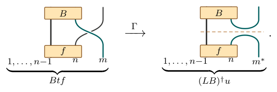

Absorption gives $LE_n=v$, hence $LB=a_nv-n!u$. The reflected crossing contributes the adjoint gluing. Insert the two gluings in [(3C.1)](#eq-tr-lift) and use [(3A.3)](#eq-tr-zero). The full fine cap has weight $a_n\binom{nk}{k}=a_n^2/a_{n-1}$. The two mixed gluings change the full packet weight to $-n\,n!+(n-1)n!=-n!$.
 □

For three packets put $a=\binom{2k}{k}$, $\Pi=E_2$ on $1,2$, $\Pi'=s\Pi s$ on $2,3$ and $g=(I+t)/2$. Before bending, the correction is

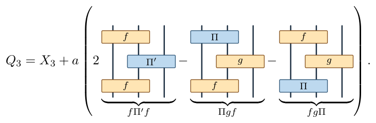

Indeed substitute $B=a\Pi-2f$, $B'=a\Pi'-2g$, $t=2g-I$ in [(3C.1)](#eq-tr-lift). The terms without $a$ give $2f-4fgf+2ftf=0$. The two straight exits in the other terms cancel $-a\Pi$ by $f\Pi=\Pi f=\Pi$.

**Definition 3C.4 (The proper cuts).**
For $0<r<k$ put $U_r=(\operatorname{id}_K\otimes c_r^{k,k})f$. Read the first two drawings as the two orders in $f$. In the third drawing merge the first two packets before taking the cap.

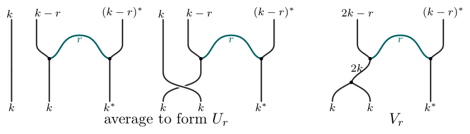

**Lemma 3C.5.**
On the full mixed boundary one has

$$
\begin{aligned}
Q_3^\Gamma
={}&2\sum_{r=1}^{k-1}\binom{k}{r}^{\!2}|U_r|^2
+a\sum_{r=1}^{k-1}\binom{2k}{r}\binom{k}{r}|V_r|^2\\
&+|av-u/2|^2-\tfrac94|u|^2 .
\end{aligned} \tag{3C.6}
$$

**Proof.**
The term $2f(B')^\Gamma f$ in [(3C.3)](#eq-tr-general) contributes the proper $U_r$-cuts by [(2F.2)](#eq-two-gap). For the full caps, join the two diagrams at their common $k$-cable:

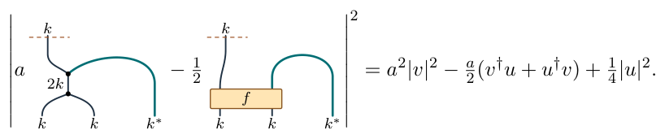

The two mixed terms are the two possible orders of gluing. The coefficient still needed on $|u|^2$ is $-2-1/4=-9/4$.
 □

### 3D. The last thin cap

Let $k\ge2$. Fix a subspace $S\subset V$ of dimension $d\ge1$. On the marked cable use $(\operatorname{Sym}^k S)^*$, extending covectors by zero on $S^\perp$. Let $j:S\hookrightarrow V$ be the inclusion and $e(x\otimes\phi)=\phi(j^\dagger x)$ the cap on $V\otimes S^*$.

**Lemma 3D.1 (Resolving the last cap).**
Put $J=I-e^\dagger e/d$. On this boundary,

$$
|U_{k-1}|^2=|J U_{k-1}|^2+|u|^2/d ,
$$

where $J$ acts on the last two thin strands.

**Proof.**
Cap those strands at the output of $U_{k-1}$. Associativity of the isometric splits joins all $k$ strands, with coefficient one.

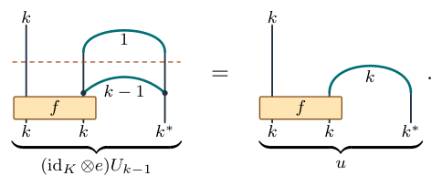

The reflected cap inserts $\sum_i j(s_i)\otimes s_i^*$ for an orthonormal basis $(s_i)$ of $S$. Close the loop and cancel $j^\dagger j$:

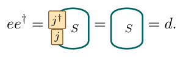

Thus $e^\dagger e/d$ is the orthogonal projection onto the cup line and $J$ projects onto $\ker e$. Insert the two projections at the dashed line and reflect:

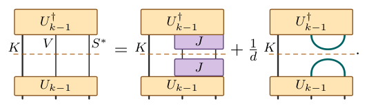

 □

For $S=V=\mathbb{C}^2$ the cup line is the span of the identity matrix. On $E_{11}$ the two projections give $\operatorname{diag}(1/2,-1/2)$ and $I/2$, each of squared norm $1/2$.

**Theorem 3D.2 (Supported three-packet decomposition).**
Let $k\ge2$ and let $S\subset V$ have dimension $1\le d\le k$.
On $K\otimes K\otimes(\operatorname{Sym}^k S)^*$ the compression of $Q_3^\Gamma$
is a sum of reflected halfwebs with positive coefficients. Consequently
Marcus's inequality holds for three packets of any common size.

**Proof.**
In [(3C.6)](#eq-tr-raw), resolve the $U_{k-1}$ cut with its coefficient $2\binom{k}{k-1}^2=2k^2$. This gives the compression

$$
\begin{aligned}
(Q_3^\Gamma)|_S
={}&2\sum_{r=1}^{k-2}\binom{k}{r}^2|U_r|^2
+a\sum_{r=1}^{k-1}\binom{2k}{r}\binom{k}{r}|V_r|^2\\
&+2k^2|J U_{k-1}|^2+|av-u/2|^2+
\left(\frac{2k^2}{d}-\frac94\right)|u|^2.
\end{aligned} \tag{3D.3}
$$

Here all lower halves are restricted to the stated boundary before reflection. The last coefficient is at least $2k-9/4>0$.

Now put matrix packets $F_1,F_2,F_3$ at the boundary. Write $T=F_1\otimes F_2\otimes F_3$ and $\xi_{ij|\ell}=F_i\otimes F_j\otimes\overline{F_\ell}$. From $[Q_3]=X_3$ and $fQ_3f=Q_3$,

$$
\langle T,X_3T\rangle
=\tfrac13\sum_{(i,j,\ell)\ {\rm cyclic}}
\langle\xi_{ij|\ell},Q_3^\Gamma\xi_{ij|\ell}\rangle .
$$

In each summand take $S$ to be the span of the $k$ vectors forming $F_\ell$. A zero packet gives zero on both sides. Otherwise $1\le\dim S\le k$, so [(3D.3)](#eq-tr-squares) applies. For $k=1$ the two closures coincide.
 □

**Example 3D.4 (All entries one).**
Take $k=2$ and $F_1=F_2=F_3=x^{\otimes2}$ for a unit vector $x$. Now $d=1$, every cap has norm one, and $JU_1$ vanishes. Read the three remaining terms of [(3D.3)](#eq-tr-squares):

$$
\underbrace{48}_{V_1}
+\underbrace{(6-1/2)^2}_{6v-u/2}
+\underbrace{8-9/4}_{\text{last cap}}
=84=\frac{6!}{(2!)^3}-3! .
$$

The six-by-six all-ones Gram matrix has the extra factor $\sqrt2$ on each packet, so its gap is $8\cdot84=720-48$. At $k=3$ one more proper cut survives, $U_1$ of weight $18$, before the last projection at $U_2$.

### 3E. Iterating the transfer

**Definition 3E.1 (Routings).**
Put a permutation of $jk$ strands between the $j$ lower and upper $k$-clasps. Let $M_{il}$ count the strands from input $i$ to output $l$. The clasps absorb their internal orders, so the web $T_M$ depends only on $M$. Each row and column sums to $k$. An entry $M_{il}=k$ is a ***whole edge***. If $b$ inputs split, then $j-b$ edges are whole and $b$ outputs split.

For example, the first input in this routing sends one strand to each of outputs $1,2$. The third packet goes straight through.

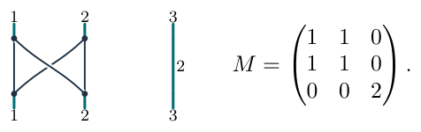

In $a_jE_j$, the coefficient of $T_M$ is $w(M)=(k!)^j/\prod_{i,l} M_{il}!$: distribute strands at every input, order them at every output and multiply by $(k!)^{-j}$. The packet clasp cancels precisely the $b=0$ tables in $X_j$. The following counts are made before evaluation in any fixed dimension.

For $D=R_{j-1}DR_{j-1}$, put $\mathcal L_j(D)=R_j(D\otimes I)R_j$. It adds one whole edge, choosing its two ends independently.

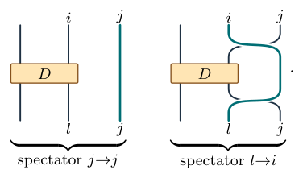

**Lemma 3E.2.**
Set $A_1=0$ and $A_j=X_j+\frac{j^2}{j-1}\mathcal L_j(A_{j-1})$ for $j\ge2$.
The coefficient of $T_M$ in $A_j$ is $(j/b)w(M)$ for $b>0$ and zero for $b=0$.

**Proof.**
Each of the $j^2$ exit pairs has the same weight by absorption. Exactly $j-b$ of them remove a whole edge from $M$. Deleting that edge preserves $b$ and $w(M)$. For $0<b<j$, induction gives

$$
1+\frac{j^2}{j-1}\frac{j-b}{j^2}\frac{j-1}{b}=\frac jb
$$

in units of $w(M)$. If $b=j$ only $X_j$ contributes, and if $b=0$ both terms vanish.
 □

For $m=n+1\ge3$, extend $A_n$ by the straight marked packet and put $A_n'=sA_ns$. Apply [Lemma 3B.2](#lem-tr-transfer) to $A_n$ to obtain

$$
Y_m=X_m-A_n+n fA_n'f-\tfrac{n-1}{2}(A_ntf+ftA_n),
\qquad [Y_m]=X_m .
$$

**Lemma 3E.3 (Which marked ends split?).**
The coefficient of each routing in $Y_m$ is determined by its two marked ends:

$$
Y_m=\sum_{M:\,b>0} w(M)\,\frac{m}{2b}
\bigl(\mathbf1_{\mathrm{input}\ m\ \mathrm{splits}}
+\mathbf1_{\mathrm{output}\ m\ \mathrm{splits}}\bigr)T_M . \tag{3E.4}
$$

**Proof.**
Mark input and output $m$ by circles. There are four possibilities for the whole edge supplied by the spectator:

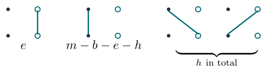

Here $e$ records the edge $m\to m$, and $h$ counts edges incident with exactly one marked end. The stationary $A_n$ uses the first position. The moved $A_n'$ has $m-b-e-h$ compatible exit pairs among $n^2$, each with old coefficient $n/b$. A crossed term has one compatible exit among $n$ for each edge meeting its marked end. Hence the relative coefficient is

$$
1-\frac nb e+\frac{m-b-e-h}{b}-\frac{n-1}{2b}h
=\frac{m}{2b}(2-2e-h).
$$

Thus $2-2e-h$ counts the split marked ends. Tables with $b=0$ remain absent.
 □

For the pictured routing $b=2$ and $w(M)=4$. The three marks give relative coefficients $3/2,3/2,0$, of mean one. In general averaging counts every split input and every split output once. Individual marked closures can be negative even on matrix packets ([Section 9](#sec-limits)).

## 4. Reflected caps with a common output

### 4A. Two partners for one cap

In [Section 3](#sec-transfer) a single cap closed the last two strands. If the dual strand can reach either of two partners, their reflections can overlap.

**Example 4A.1 (One supported strand).**
Take $S=\mathbb{C} e$ for a unit vector $e\in V$, and set $\bar e=\langle e,-\rangle$. Put the dual between its two possible partners:

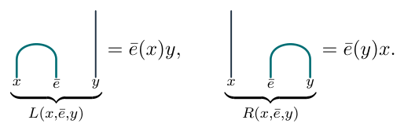

Glue the left cap to each reflected route along the three strands. The small box on the middle strand restricts it to $S^*$.

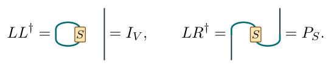

The first loop has value $\dim S=1$. The second path sends $z$ to $\bar e(z)e$. Thus the two reflected vectors $L^\dagger z,R^\dagger z$ coincide for $z=e$ and are orthonormal for a unit $z\perp e$. Adding their separate projections would count $L^\dagger e$ twice.

### 4B. The intersection form

Write $K_j(U)=\operatorname{Sym}^j U$. Fix an $s$-dimensional subspace $S\subset V$, $s\ge1$, and extend its covectors by zero on $S^\perp$.

**Definition 4B.1 (Routed cap).**
Take cables $d_1,\ldots,d_h$ and a dual cable $r$ in $S^*$. Choose $0\le\alpha_i\le d_i$ with $\sum_i\alpha_i=r$. The ***routed cap*** $C_\alpha$ splits off $\alpha_i$ strands from cable $i$, caps them against the corresponding piece of the dual, and merges the $N=\sum_i d_i-r$ survivors. All splits are isometric.

Here are $C_{(\alpha_1,\alpha_2)}$ and its gluing with $C_\beta^\dagger$. Both pictures put the dual between the positive cables.

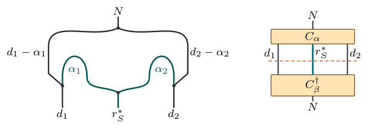

In general the common input is $X=\bigotimes_iK_{d_i}(V)\otimes K_r(S)^*$, and the common output is $K_N(V)$. Write $Z_\ell$ for the span of the symmetric words with $\ell$ letters in $S$ and $N-\ell$ in $S^\perp$, in a basis adapted to $S$. These spaces are orthogonal and sum to $K_N(V)$. We only use the nonzero ones.

**Lemma 4B.2 (Intersection form of routed caps).**
On $Z_\ell$ every $C_\alpha C_\beta^\dagger$ is scalar. Its value is a nonnegative rational linear combination of

$$
s^j\frac{\binom{\ell}{q}}{\binom Nq},
\qquad 0\le q\le N,\quad j+q\le r ,
$$

with coefficients depending only on the cable sizes and routes.
Let $G_\ell$ be the matrix of these scalars for a column $C=(C_\alpha)_\alpha$. The orthogonal projector onto $\sum_\alpha\operatorname{im}C_\alpha^\dagger$ is

$$
C^\dagger\Big(\bigoplus_\ell G_\ell^+\otimes I_{Z_\ell}\Big)C ,
$$

where $G_\ell^+$ inverts the positive eigenvalues and vanishes on the kernel.

**Proof.**
Open the internal clasps into permutations. Every closed component passes through the marked dual and gives an $S$-loop. Every open path through the dual carries $P_S$, since $P_S^2=P_S$. The outer clasps absorb the order of the paths:

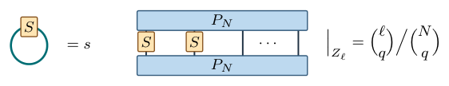

Of the $\binom Nq$ placements of $q$ marks, $\binom\ell q$ survive. Each of the $j$ loops and $q$ marked paths uses a different segment of the $r$-strand dual seam. This gives $j+q\le r$. Each term has the positive rational weight from its clasp averages.

For a unit $z\in Z_\ell$, $G_\ell$ is the Gram matrix of the vectors $C_\alpha^\dagger z$. Thus $G=CC^\dagger=\bigoplus_\ell G_\ell\otimes I_{Z_\ell}$. The self-adjoint $C^\dagger G^+C$ is idempotent by $G^+GG^+=G^+$. Its image lies in $\operatorname{im}C^\dagger$, and it fixes that space since $\ker G=\ker C^\dagger$. This proves the projector formula.
 □

**Example 4B.3 (Two marked strands).**
Take orthonormal $e\in S$, $f\in S^\perp$, and $z=e\odot e\odot f$. Mark two strands of the $3$-cable by $P_S$ and place $f$ in each of its three positions:

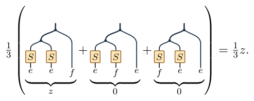

Only the word with $f$ on the unmarked strand survives. This gives $\binom22/\binom32=1/3$.

## 5. Four packets and the intersection of cap routes

A fourth packet gives the last dual strand a choice of partners. We use the intersection form of [Section 4](#sec-intersection) to close it.

### 5A. Several last caps at one output

**Definition 5A.1 (Last caps).**
Fix $S\subset V$ of dimension $s\ge1$ and let $d_1+\cdots+d_h=N+1$, where $N,d_i\ge1$. Take one strand from cable $i$, cap it against $S^*$ and merge the survivors. This defines

$$
C_i:\Big(\bigotimes_{j=1}^h\operatorname{Sym}^{d_j}V\Big)\otimes S^*
\longrightarrow Z=\operatorname{Sym}^N V .
$$

Here are the two choices for $h=2$.

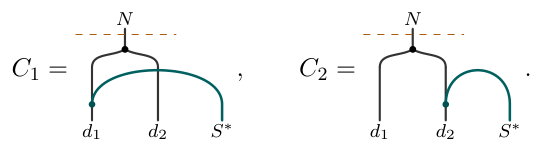

Gluing at the dashed $N$-cable gives $C_2^\dagger C_1$. For the intersection form we glue at the other ends: place $C_2^\dagger$ below $C_1$ and join all $h+1$ cables. The resulting $C_1C_2^\dagger$ acts on $Z$.

**Example 5A.2.**
Take $S=V$ with orthonormal basis $a,b$ and $d_1=d_2=1$. Put $a$ into each reflected cap. Read the output as $V\otimes V\otimes V^*$:

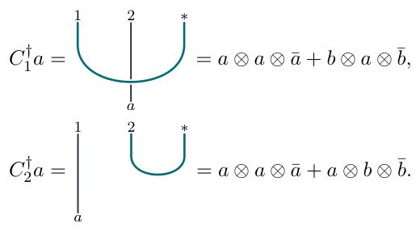

The rows share the word $a\otimes a\otimes\bar a$. Their Gram matrix is $G=\left(\begin{smallmatrix}2&1\\1&2\end{smallmatrix}\right)$. The shared word has inner product one with each row. Its two separate projections have squared norms $1/2$ and $1/2$, while its joint projection has squared norm $(1,1)G^{-1}(1,1)^t=2/3$.

Write $Z_\ell$ for the output with $\ell$ of its $N$ strands in $S$ and the others in $S^\perp$.

**Lemma 5A.3 (Intersection of last caps).**
Put $\rho=\ell/N$. On $Z_\ell$ the Gram matrix of the reflected halves is

$$
C_i C_j^\dagger=G_{ij}\,I,\qquad
G_{ij}=\rho+(s-\rho)\frac{\delta_{ij}}{d_i}. \tag{5A.4}
$$

If $s>\rho$, its inverse gives the orthogonal projector onto the span of the
reflected images in that sector. In column notation $C=(C_1,\ldots,C_h)^t$
the projector is $C^\dagger G^{-1}C$, with the output restricted to $Z_\ell$.

**Proof.**
Follow the strand from cup to cap. A loop can close only if the two turns lie on the same cable. The symbol $*$ collects the other cables.

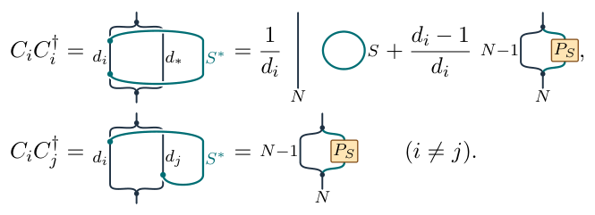

The cup returns to its own slot with weight $1/d_i$, giving a loop of value $s$. All other routes put $P_S$ on one output. The clasp averages that mark over $N$ ends, of which $\ell$ lie in $S$. This gives [(5A.4)](#eq-fourports). For $s>\rho$ the matrix $G=(s-\rho)\operatorname{diag}(1/d_i)+\rho\mathbf{1}\mathbf{1}^t$ is positive definite. Apply [Lemma 4B.2](#prop-routedcaps).
 □

For $s=\rho=1$ use the inverse on the image of $G$. In either case, putting $b_i=(C_i z)_\ell$, the joint projection has squared norm $q_{\boldsymbol d}(b)=\sum_{ij}(G^+)_{ij}\langle b_i,b_j\rangle$.

### 5B. A second packet transfer

The straight cut on packet four leaves $X_3$ on the other three. To move its mark, work first on four upright cables $K=\operatorname{Sym}^kV$. Put $t=(14)$, $\sigma=(34)$ and

$$
H=R_{12},\quad F=R_{123},\quad g=R_{23},\qquad
a=\binom{2k}{k},\quad b=\binom{3k}{k},\quad c=ab .
$$

Here $R_I$ averages the packets in $I$. Write $P=P_{2k}$ on $12$, $P'=(13)P(13)$ on $23$ and $E=P_{3k}$ on $123$. The three-packet correction marked at $3$ is

$$
B=X_3+a(2HP'H-PgH-HgP),\qquad X_3=cE-6F .
$$

It acts trivially on packet four, absorbs $H$ and satisfies $[B]_{S_3}=X_3$. Write $[\;]$ for simultaneous relabeling averaged over $S_4$.

**Lemma 5B.1 (Moving the mark to packet four).**
Let $C=2B-X_3$. The transferred operator is

$$
Q=X_4-X_3+3F\sigma B\sigma F-F(Ct+tC)F,\qquad [Q]=X_4,\quad FQF=Q . \tag{5B.2}
$$

**Proof.**
Inside the average, slide the two copies of $F$ together, absorb, and relabel by $\sigma$. This gives $[F\sigma B\sigma F]=[B R_{124}]$. Open $R_{124}$ according to the input reaching output four:

![Open the three possible exits of the clasp on packets 1, 2 and 4. They give B, B(14) and B(24). After relabeling, the two interchanges contribute equally, giving 3\[BR₁₂₄\] = \[B\] + 2\[Bt\].](../figures/web-5b-01.png)

**(5B.3)**

The residual $12$-clasp absorbs into $B$. Relabeling $1,2$ identifies the last two summands inside the bracket.

To remove the two crossed terms, split $H=F+J$ into orthogonal projectors. The two nonstraight exits of $F$ give the same crossing between $12$-clasps:

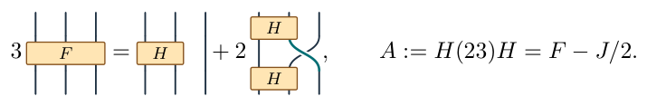

Thus $D=HgH=(H+A)/2=F+J/4$. Since $P=HPH$, $(B-X_3)/a=2APA-PD-DP$. Multiplying the $F,J$ entries gives

$$
\frac{B-X_3}{a}=
\begin{pmatrix}0&-\frac94 FPJ\\[-1pt]-\frac94 JPF&0\end{pmatrix}_{F,J}.
$$

Multiplication by $F$ at both ends fixes $X_3$. The map $C\mapsto FC+CF$ doubles its $F,F$ block and keeps each off-diagonal block, so $FC+CF=2B$ for $C=2B-X_3$. Slide $F$ and $t$ inside the average:

$$
[F(Ct+tC)F]=[(FC+CF)t]=2[Bt].
$$

Now [(5B.3)](#eq-fourmarked) and $[B]=X_3$ give $[Q]=X_4$. Each summand of $Q$ absorbs the outer $F$ already on the ordered boundary.
 □

### 5C. Opening the marked diagram

**Definition 5C.1 (The three cap routes).**
Bend packet four. Before contracting its $r$ strands, use one packet, merge two, or merge all three. The $F$ at the feet averages the three upright labels.

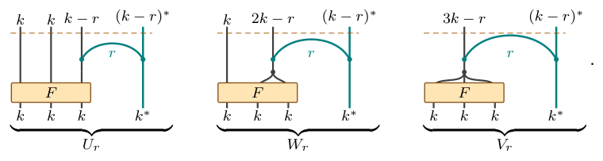

For $r=k$ write $u,w,v$, respectively. Let $L$ cap $14$, leaving the ordered outputs $23$. Split the output of $v$ isometrically into two $k$-cables and order the outputs of $w$ to match. Then $u=LF$, $w=LPF$ and $v=LE$ take values in $K\otimes K$. Its fine clasp $p=P_{2k}$ fixes $v$.

Write $|D|^2=D^\dagger D$ and $\operatorname{Re}D=(D+D^\dagger)/2$.

**Lemma 5C.2 (Three families of cuts).**
With $\Gamma$ the bend on packet four, the following is an identity of
open webs:

$$
\begin{aligned}
Q^\Gamma={}&
\sum_{r=1}^{k-1}\binom kr\left(6\binom kr|U_r|^2+
3a\binom{2k}r|W_r|^2+c\binom{3k}r|V_r|^2\right)\\
&+cb\,|v-pu/b|^2+3a^2|w|^2-12|u|^2-4a|pu|^2 .
\end{aligned} \tag{5C.3}
$$

**Proof.**
The straight cuts of $X_4$ cancel $X_3$. Each proper cut of $X_4$ has coefficient $c\binom{3k}{r}\binom kr$ on $V_r$. Each moved $B$ contributes $2\binom kr^2$ on $U_r$ and $a\binom{2k}r\binom kr$ on $W_r$ by [(3C.6)](#eq-tr-raw).

At the full cap $X_4$ gives $cb|v|^2-18|u|^2$. In one moved $B$ the two clasp terms give $a^2|w|^2-4|u|^2$. Its two-packet gap has only proper cuts, and its crossed terms glue $aw-2u$ to $u$ in both orders with coefficient $-1/2$. This leaves $a^2|w|^2-2|u|^2-a\operatorname{Re}(w^\dagger u)$ per copy.

Bending $t$ gives $L^\dagger L$. Thus the last term of [(5B.2)](#eq-fourq) gives $-2\operatorname{Re}((LCF)^\dagger u)$, where the $J,F$ block above gives $LCF=cv-6u-(9a/2)LJPF$. Open $FPF=(P_{12}+P_{13}+P_{23})F/3$ under $L$:

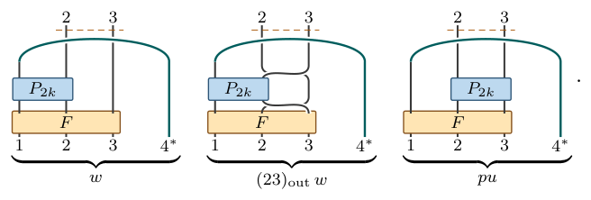

The first two placements glue equally to $u$ since its output is symmetric. The last gives $|pu|^2$. As $JPF=PF-FPF$,

$$
3\operatorname{Re}((LJPF)^\dagger u)=\operatorname{Re}(w^\dagger u)-|pu|^2.
$$

The mixed $w,u$ terms cancel. Complete the square in $v,pu$, using $pv=v$ and $c/b=a$.
 □

### 5D. Resolving the quadratic cut

**Theorem 5D.1 (Four quadratic packets).**
For $k=2$, the compression of $Q^\Gamma$ to
$K^{\otimes3}\otimes(\operatorname{Sym}^2 S)^*$ is positive semidefinite for every
$S\subset V$ of dimension at most two. Marcus's inequality holds for
four quadratic blocks.

**Proof.**
Enlarge $V$ isometrically and extend $S$ to a two-plane. For a supported input $\xi$ put $F$ on the three upright feet. The two caps can now meet one packet or two. Merge the survivors in $Z=\operatorname{Sym}^4 V$:

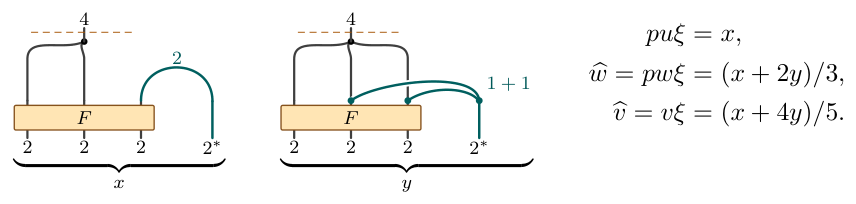

For $w$, two of the six choices of strands come from the same packet. For $v$, three of the fifteen do. The $F$ at the feet and the output clasp identify the choices of each kind.

There is one proper cut, $r=1$. Split the two spectators of $U_1$ by $p+(I-p)$. On $I-p$, the last cap $e:V\otimes S^*\to\mathbb{C}$ has bubble $2$. The trace part of $24|(I-p)U_1|^2$ therefore cancels $12|(I-p)u|^2$, leaving the square with projector $I-e^\dagger e/2$. The remaining last caps have the following values.

$$
\begin{array}{c|c|c|c}
\text{half after one cap}&\text{bundle sizes }\boldsymbol d&
\text{last cap values in }Z&\text{weight}\\ \hline
pU_1&(4,1)&(y,x)&24\\
W_1&(2,3)&(y,\widehat w)&144\\
V_1&(5)&(\widehat v)&1080 .
\end{array}
$$

In the first row the two possible partners are visible:

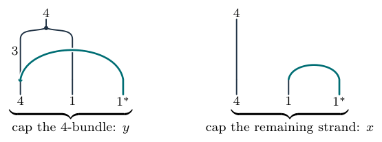

In the second row the spectator gives $y$ and the merged pair gives $\widehat w$. Apply [Lemma 5A.3](#lem-fourports) row by row. Set aside the complementary squares and $108\|(I-p)w\xi\|^2$. In $Z_\ell$ the form left on $x,y$ is

$$
\begin{aligned}
&24 q_{(4,1)}(y,x)+144q_{(2,3)}(y,\widehat w)+1080q_{(5)}(\widehat v)\\[-2pt]
&\hspace{13mm}{}+1350\|\widehat v-x/15\|^2+108\|\widehat w\|^2-36\|x\|^2 .
\end{aligned}
$$

Here $-36=-12-4a$. Inverting [(5A.4)](#eq-fourports) with $s=2$, $\sum_i d_i=5$, gives

$$
q_{\boldsymbol d}(z)=\frac{1}{2-\rho}\left(
\sum_i d_i\|z_i\|^2-\frac{\rho}{2+4\rho}\Big\|\sum_i d_i z_i\Big\|^2\right),
\qquad \rho=\ell/4 .
$$

Substitute the two full-cap values from the drawing. With $D=(2-\rho)(1+2\rho)$ the matrix on $(x,y)$ is

$$
\begin{aligned}
M&=\frac{24}{D}\begin{pmatrix}
2(6-\rho)&54-3\rho-14\rho^2\\
54-3\rho-14\rho^2&2(122+17\rho-38\rho^2)
\end{pmatrix},\\[2pt]
\det M&=\frac{576(98\rho^2+113\rho+6)}{D}.
\end{aligned}
$$

Both $M_{11}$ and $\det M$ are positive for $0\le\rho\le1$. The two remaining squares are

$$
M_{11}\|x+M_{12}y/M_{11}\|^2+
(\det M/M_{11})\|y\|^2 .
$$

For instance, at $\ell=0$ they give $144\|x+(9/2)y\|^2+12\|y\|^2$. This proves positivity on the supported space. For the matrix inequality take $S$ to contain the two atoms of the marked packet. Evaluate on the packet product and average the four marks by [(5B.2)](#eq-fourq).
 □

## 6. Two packets on each side

Bend packets $3,4$ and leave $1,2$ upright. A packet cap joins one upright packet to one turned packet. The four choices $13,14,23,24$ each leave one ordinary and one dual packet.

### 6A. Moving two boxes at once

**Definition 6A.1 (The three pairings).**
Put $K=\operatorname{Sym}^kV$ and $a=\binom{2k}{k}$. On the four upright cables let $\Pi_{ij}=P_{2k}$ and let $f_{ij}$ average the orders of packets $i,j$. For each pairing put

$$
B_{ij|hl}=a^2\Pi_{ij}\Pi_{hl}-4f_{ij}f_{hl}.
$$

This is the zero-cap term, by the Schur relation at $(2k,2k)$ on strands and $(2,2)$ on packets. For $p=12|34$ the other two pairings cross the proposed bend:

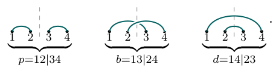

Move $B_p$ onto the crossing pairs before bending. Each $B$ occurs once with coefficient $-1$ and twice with $1/2$. Hence, on the upright boundary,

$$
Y_p=X_4-B_p+\tfrac12(B_b+B_d),\qquad
\tfrac13\sum_{p=12|34,13|24,14|23}Y_p=X_4. \tag{6A.2}
$$

Now let $\Gamma_p$ bend $3,4$, giving $K^{\otimes2}\otimes(K^*)^{\otimes2}$. Merge the two cables on each side and cap the merges at the two scales shown:

Let $L_e$ cap the two packets of edge $e$, leaving the other two ordered as $K,K^*$. Equal weights on the four slots give

At the full cap a first partner determines the other. Write $N_M$ for the scalar cap along both edges of $M$.

**Lemma 6A.3 (Opening the balanced cut).**
Set $w_r=\binom kr^2$, $C_{e,r}=c_r^{k,k}$ on edge $e$ and $|D|^2=D^\dagger D$. Juxtapose the two caps for each $M$. Then

$$
\begin{aligned}
Y_p^{\Gamma_p}
={}&\mathcal F_p+
\frac12\sum_{\substack{M\in\{b,d\}\\M=\{e,e'\}}}
\sum_{\substack{0\le r,t\le k\\(r,t)\notin\{0,k\}^2}}
w_r w_t\,|C_{e,r}C_{e',t}|^2
-\Big|\sum_{e\text{ crossing }p}L_e\Big|^2-|N_b+N_d|^2,
\\[-2pt]
&\mathcal F_p=a^2\sum_{r=1}^{2k}\binom{2k}{r}^{\!2}|H_r|^2.
\end{aligned} \tag{6A.4}
$$

**Proof.**
The two Schur cuts of $X_4-B_p$ give $\mathcal F_p-16|J_1|^2-4|J_2|^2$. The coefficients $16,4$ cancel the squared denominators in the two drawings. On each edge of a crossing pairing, opening $a\Pi_e$ gives $\sum_r w_r|C_{e,r}|^2$. Its two extremes open $2f_e$. Their products on both edges cancel precisely the four corners $(r,t)\in\{0,k\}^2$.
 □

### 6B. Completing a proper cut

Choose a $k$-plane $S$ containing the atoms of each turned packet, one plane per packet. Enlarge $V$ isometrically if necessary and restrict each turned cable to $(\operatorname{Sym}^k S)^*$ for its chosen plane.

**Lemma 6B.1 (Last-cap weight).**
In [(6A.4)](#eq-cubic-open) the proper cuts supply $L/2$ times $|L_e|^2$ for each crossing edge and $L$ times $|N_M|^2$ for each crossing pairing, where

$$
L=\sum_{r=1}^{k-1}\binom kr^{\!2}\binom{2k-r-1}{k-r}^{-1}. \tag{6B.2}
$$

The remainders of these cuts are sums of squares.

**Proof.**
A proper $r$-cut leaves $t=k-r$ on each side. Let $E_t$ cap the survivors and write $K_t(S)=\operatorname{Sym}^t S$. Completing and reflecting give

Associativity gives $E_t C_{e,r}=L_e$. The loop has value $d_t=\binom{k+t-1}{t}$, so $E_t^\dagger E_t/d_t$ projects onto the trace and the complementary projector gives a square. Apply this split along the edges of the square of cut indices:

Along a bottom or left edge the other cap is empty, giving $|L_e|^2$ or $|L_{e'}|^2$. Along a top or right edge it is full, giving $|N_M|^2$ twice. Summing $w_r/d_{k-r}$ and multiplying by $1/2$ gives the asserted weights. Interior entries are reflected squares.
 □

**Lemma 6B.3 (Four packets of thickness at least four).**
For $k\ge4$ each $Y_p^{\Gamma_p}$ is positive on the fixed supported space above. The four-block inequality follows.

**Proof.**
For $k=4$ the summands of $L$ are $4/5,18/5,4$. For $k\ge5$ its last two terms sum to $k+k(k-1)^2/(2(k+1))\ge8$. Thus $L/2\ge4$ and $L\ge2$, enough to close both differences:

$$
4\sum_e|L_e|^2-\Big|\sum_eL_e\Big|^2=\sum_{e<e'}|L_e-L_{e'}|^2,
\qquad
2(|N_b|^2+|N_d|^2)-|N_b+N_d|^2=|N_b-N_d|^2.
$$

All unused diagonals and $\mathcal F_p$ are positive on this space. Evaluate each bend on the corresponding packet product and average by [(6A.2)](#eq-cubic-move).
 □

**Example 6B.4 (The missing cubic coefficient).**
For $k=3$ the two bubbles have dimensions $6,3$, so $L=9/6+9/3=9/2$. Put the same unit packet at all four feet. The four $L_e$ then give the same unit vector. Their sum has squared norm $16$ while their available diagonal has value $(9/4)\cdot4=9$. At this degree we shall also use the inner products of the surviving packets.

### 6C. Signing the four surviving routes

From now on insert four unit matrix packets $F_i$ of thickness three. A zero packet gives equality, and scaling the packets multiplies both closures by the same factor. For $e=ij$ and $M=\{e,e'\}$ put

$$
x_e=|\langle F_i,F_j\rangle|^2,\quad s_M=x_e x_{e'},\qquad
P=\sum_e x_e,\quad S=\sum_Ms_M,\quad D_p=\sum_{e\text{ crossing }p}x_e .
$$

Each of the six edges crosses two cuts, so $\sum_pD_p=2P$.

Fix $p$ and write the four inputs as $U_1,U_2,\bar V_1,\bar V_2$. Let $i'=3-i$, $j'=3-j$. The cap gives $\alpha_{ij}=\langle V_j,U_i\rangle$ and the full halfweb gives $l_{ij}=\alpha_{ij}U_{i'}\otimes\bar V_{j'}$. In the square of routes a horizontal edge changes $j$ and a vertical edge changes $i$.

Let $D e_{ij}=U_{i'}\otimes\bar V_{j'}$. Let $A$ be the off-diagonal Gram matrix of $U_2,U_1$ on the row index and $B$ the off-diagonal Gram matrix of $\bar V_2,\bar V_1$ on the column index. They commute.

**Lemma 6C.1 (The signed gluing).**
For $t>0$,

$$
\begin{gathered}
(2+t^2+t^{-2}s_p)D_p-\Big\|\sum_{i,j}l_{ij}\Big\|^2\\
=\Big\|\sum_{i,j}(-1)^{i+j}l_{ij}\Big\|^2
+\Big\|(tI-t^{-1}AB)\alpha\Big\|^2.
\end{gathered} \tag{6C.2}
$$

**Proof.**
The middle drawing gives $D^\dagger D=(I+A)(I+B)$. For instance, a horizontal edge has value $\langle U_{i'},U_{i'}\rangle\langle\bar V_2,\bar V_1\rangle$. Multiply route $ij$ by $(-1)^{i+j}$. The horizontal and vertical edges change sign and the diagonals keep their signs. Adding the two gluings thus gives $2I+2AB$. Now $(AB)^2=s_pI$ by the two off-diagonal Gram products. Adding $(tI-t^{-1}AB)^2$ gives $(2+t^2+t^{-2}s_p)I$. Evaluate on $\alpha$, whose squared norm is $D_p$.
 □

At $t=1/2$ the constant term is the available $9/4$. Read the two parts of the last square as caps:

Unused unit packets close against their reflections. This calculation takes place on the inserted product.

**Theorem 6C.3.**
For four matrix packets of thickness three the clasp difference has a nonnegative closure in every Gram dimension.

**Proof.**
On an opposed edge the two extreme cuts give $g_e=1+x_e$, and the proper cuts give $\delta_e=Lx_e+\tau_e$ with $\tau_e$ the sum of the complementary squares. Reversing the bend preserves $\tau_e$ since $g_e+\delta_e$, $g_e$ and $x_e$ are symmetric. Disjoint pair closures multiply on the product boundary. Each crossing pairing occurs twice with weight $1/2$. Summing their contributions gives

$$
\begin{gathered}
\sum_{M=\{e,e'\}}
[(g_e+\delta_e)(g_{e'}+\delta_{e'})-g_e g_{e'}]
= L P+(L^2+2L)S+T,\\[-1pt]
T=\sum_{M=\{e,e'\}}\bigl(
\tau_e[1+(1+L)x_{e'}]+\tau_{e'}[1+(1+L)x_e]+\tau_e\tau_{e'}\bigr).
\end{gathered}
$$

For the full caps the mixed gluing is a four-cycle. Read the arrow $X\to Y$ as $\langle X,Y\rangle$:

Each squared modulus occurs in two cuts, so

$$
4S-\sum_p|N_b+N_d|^2=\sum_p|N_b-N_d|^2 .
$$

On the four crossing edges $4-D_p=\sum(1-x_{ij})=\sum\|F_i\wedge F_j\|^2$ in the determinant metric. Let $G_4$ be the unbent closure and $\mathcal F$ the sum of the three fine contributions $\mathcal F_p$. Substitution into [(6A.4)](#eq-cubic-open) gives

$$
\begin{aligned}
3G_4={}&\mathcal F+T+\tfrac{37}{4}S\\
&+\sum_p\left(
\Big\|\sum_{i,j}(-1)^{i+j}l_{ij}\Big\|^2
+\Big\|(I/2-2AB)\alpha\Big\|^2
+|N_b-N_d|^2+4s_p(4-D_p)\right).
\end{aligned}
$$

Indeed $(9/4)\sum_pD_p=LP$. Of the coefficient $L^2+2L=117/4$ on $S$, the exterior squares use $16$ and the full caps use $4$, leaving $37/4$. Each displayed term is nonnegative.
 □

## 7. Disjoint packet pairs

The straight term at a merge of two cables $D\in K_p$, $E\in K_q$ is

$$
(p+q)!\|D\odot E\|^2\ge p!q!\,\|D\|^2\|E\|^2,
\qquad D\odot E=P_{p+q}(D\otimes E). \tag{7.1}
$$

This is the $r=0$ cut in [Lemma 2C.6](#thm-bent). How many full caps do the other cuts contain?

### 7A. Completing a partial cap

**Lemma 7A.1 (Full caps from one pair).**
Let $F\in K_k$ have norm one and be proportional to $x_1\odot\cdots\odot x_k$. For every $Z\in K_k$,

$$
\binom{2k}{k}\|F\odot Z\|^2
\ge \|Z\|^2+(2^k-1)|\langle F,Z\rangle|^2.
$$

For fixed $F$ the difference is a sum of squared norms in $Z$.

**Proof.**
Write $x_I=\bigodot_{i\in I}x_i$, with $x_\varnothing=1$. The $r+(k-r)$ split averages $x_I\otimes x_{I^c}$ over the $\binom kr$ subsets of size $r$. Thus the surviving positive cable of $Y_r=c_r^{k,k}(F\otimes\bar Z)$ lies in
$W_r=\operatorname{span}\{x_{I^c}:|I|=r\}$, of dimension $1\le d_r\le\binom kr$. Close it against the surviving dual cable:

The final cap $e$ has bubble $ee^\dagger=d_r$. Insert $J_r=I-e^\dagger e/d_r$ and $e^\dagger e/d_r$ at the dashed line. The $r$th cut gives $\binom kr^2\|J_rY_r\|^2$ and $\binom kr^2/d_r$ copies of $|\langle F,Z\rangle|^2$. For $r\ge1$ retain $\binom kr$ copies. Their sum is $2^k-1$ and the straight cut gives $\|Z\|^2$. Only $F$ enters the choice of $W_r$.
 □

**Example 7A.2.**
Take $F=Z=(e\otimes f+f\otimes e)/\sqrt2$ for orthonormal $e,f$.
Then $Y_1=(ee^\dagger+ff^\dagger)/2$ has trace one and squared norm $1/2$.
The one-cap terms contribute $4/2=2$ and the double cap contributes one. Including the straight term gives equality at $4$.

### 7B. Two closures on matchings

Take all packets $F_i$ of norm one. Both closures scale by $\prod_i\|F_i\|^2$ and vanish for a zero packet.

**Definition 7B.1 (Matching closures).**
A matching $L$ on $I$ is a set of disjoint pairs of labels. Write $g_{ij}=\langle F_i,F_j\rangle$ and draw an edge $ij$ for its reflected cap:

Put $p_L=\prod_{ij\in L}p_{ij}$ and let $Z_r(I)$ be the mean of $p_L$ over matchings of size $r$, with $Z_0=1$.

**Example 7B.2.**
On four labels $6Z_1=\sum_{i<j}p_{ij}$ and

In the middle picture the edges $13$ and $24$ have no common endpoint.

**Lemma 7B.3 (The fine closure).**
Put $m=|I|$, $n=\lfloor m/2\rfloor$ and $b=2^k-1$. On matrix packets,

$$
N(I)=\frac{(mk)!}{(k!)^m}\Big\|\bigodot_{i\in I}F_i\Big\|^2
\ \ge\ \sum_{r=0}^n\binom nr b^r Z_r(I). \tag{7B.4}
$$

**Proof.**
Merge the $n$ pairs of a maximum matching $M$. The last cable has thickness $\epsilon k$ for $\epsilon=m-2n$. Take the straight term above the cut and apply [Lemma 7A.1](#lem-threshold-pair) below:

The upper factorials cancel by [(7.1)](#eq-th-straight). Choose the $r$ pairs contributing $bp_{ij}$ in $\binom nr$ ways. Averaging $M$ makes their matching uniform by relabeling. Every discarded square is nonnegative.
 □

For $q=|I|\ge2$ let $H(I)=\operatorname{per}(g_{ij})_{i,j\in I}$, with $H(\varnothing)=1$. Mark $t\in I$ and cap it against $i\ne t$. The surviving cable is $x_i=g_{ti}R_{q-2}\bigotimes_{a\in I\setminus\{t,i\}} F_a$. Two such routes have the same output:

For $q=3$ and $t=3$ these two routes give $g_{31}F_2$ and $g_{32}F_1$. Their mixed gluing is the triangle $g_{13}g_{32}g_{21}$.

**Lemma 7B.5 (The packet closure).**
Averaging the marked cap over $I$ gives

$$
\begin{aligned}
H(I)&=\frac1q\sum_{t\in I}H(I\setminus\{t\})
+\frac{2(q-1)}q\sum_{i<j}p_{ij}H(I\setminus\{i,j\})-E(I),\\
E(I)&=\frac{(q-2)!}{q}\sum_{t\in I}\sum_{\substack{i<j\\i,j\ne t}}\|x_i-x_j\|^2 .
\end{aligned} \tag{7B.6}
$$

**Proof.**
Open the $(q-1,1)$ clasp. Its straight term is $H(I\setminus\{t\})$. Each of the other $q-1$ exits has amplitude $1/(q-1)$ from the split, so the cap contributes $(q-2)!\|\sum_i x_i\|^2$.
Expand this square as $(q-2)!\big((q-1)\sum_i\|x_i\|^2-\sum_{i<j}\|x_i-x_j\|^2\big)$. In the mark average each diagonal edge $ti$ occurs twice, once from either end.
 □

**Lemma 7B.7.**
One has $H(I)\le U(I):=\sum_r A_{q,r} Z_r(I)$, where

$$
A_{q,r}=A_{q-1,r}+(q-1)^2 A_{q-2,r-1},
\qquad A_{0,0}=A_{1,0}=1 \tag{7B.8}
$$

and other initial or out-of-range entries are zero.

**Proof.**
Drop $E$ at each cut. Deleting a uniform vertex leaves $Z_r$ unchanged under averaging. Appending the deleted edge to a matching on its complement raises its degree by one and gives the factor $\binom q2\,2(q-1)/q=(q-1)^2$. The error $U-H$ is a sum of reflected squares multiplied by disjoint $p_L$.
 □

### 7C. The block size

**Theorem 7C.1.**
For $m\ge2$, the block-permanent inequality holds on complex positive semidefinite matrices whenever

$$
2^k-1\ \ge\ \frac{m(m-1)(2m-1)}{6\lfloor m/2\rfloor}.
$$

**Proof.**
Write $A_m(z)=\sum_r A_{m,r}z^r$. By [(7B.8)](#eq-th-count) this is the matching polynomial with positive weights $j^2 z$ on the successive edges of an $m$-vertex path. Omit the last edge, or choose it and remove its neighbour:

The vertices here count deletion steps. Let $J_m$ be the real symmetric matrix with entries $j$ on the edges $j,j+1$ and zeros elsewhere.
Expanding its tridiagonal determinant along the last row gives
$\det(tI-\mathrm iJ_m)=\sum_r A_{m,r}t^{m-2r}$.
Changing the signs of alternate coordinates conjugates $J_m$ to $-J_m$. Its eigenvalues thus come in pairs $\pm\lambda_i$, with one extra zero for odd $m$. It follows that

$$
A_{m,r}=e_r(\lambda_1^2,\ldots,\lambda_n^2),\qquad
A_{m,1}=\tfrac12\operatorname{tr}(J_m^2)=\sum_{j=1}^{m-1}j^2 .
$$

Here $e_r$ is the sum of all products of $r$ distinct entries. For fixed sum, averaging any two nonnegative entries can only increase $e_r$: their sum is unchanged and their product increases. Hence $A_{m,r}\le\binom nr(A_{m,1}/n)^r\le\binom nr b^r$. Compare the two bounds term by term using $Z_r\ge0$.
 □

**Example 7C.2.**
For four packets the polynomial in the picture is $1+14z+9z^2$. The fine coefficients are $1,2b,b^2$. At $k=3$ they give $1,14,49$; at $k=2$ the single-edge coefficient is only $6$.
For five packets [Theorem 7C.1](#thm-threshold) gives $k\ge4$.

### 7D. Four labels inside the packet clasp

For four labels $J$, let $P_J=\sum_{ij\subset J}p_{ij}$ and let $D_J$ be the sum of the three products in [Example 7B.2](#ex-th-matchings).

**Lemma 7D.1.**
For $u>0$,

$$
H(J)\le 1+\frac{5+2u}{3}P_J+\frac{5+4/u}{3}D_J . \tag{7D.2}
$$

**Proof.**
For a division into two pairs, let $D$ sum the four crossing $p_{ij}$ and let $s$ be the product on the two internal edges. In [(6C.2)](#eq-cubic-signed) take $t=\sqrt u$. The one-cap contribution is at most $(2+u+s/u)D$. Over the three divisions, $\sum D=2P_J$ and $\sum sD\le4D_J$ since $p_{ij}\le1$. The straight terms total $3+P_J+D_J$. Bounding a full-cap sum by twice its two diagonal squares gives $4D_J$ in total. Divide by three. The slack $1-p_{ij}=\|F_i\wedge F_j\|^2$ (with the determinant metric) and the differences of the two full-cap halves give reflected squares.
 □

For $u=1$ the right side is $U(J)$. For $u<1$ the one-edge coefficient decreases and the two-edge coefficient increases. With $r$ disjoint spectator edges the change is in degrees $r+1,r+2$.

**Lemma 7D.3.**
For $m\ge4$ set $h_{m,0}=\binom m3$ and $h_{m,r}=h_{m-1,r}+(m-1)^2h_{m-2,r-1}$ for $r>0$. Set $h_{m,r}=0$ outside $m\ge4$, $0\le2r\le m-4$. Define the real tridiagonal matrix on $1\le j\le\lfloor m/2\rfloor=n$ by

$$
M_{jj}=\binom nj b^j-A_{m,j}+h_{m,j-1}+h_{m,j-2},
\qquad M_{j,j+1}=M_{j+1,j}=-h_{m,j-1}.
$$

If $M\succeq0$, the block-permanent inequality holds at $(m,k)$.

The spectator count is given in the proof in [Appendix A](#sec-th-app).

**Example 7D.4.**
At $(m,k)=(6,4)$ one has $b=15$, $(A_{6,j})=(1,55,439,225)$ and $(h_{6,r})=(20,100)$. The three elimination pivots are $10,316,254250/79$. All are positive, although $3b<55$.

### 7E. A triangle and a four-cycle

On unit packets compare these two scalar gluings:

Glue the reflection of the left to the right to obtain the triangle $\bar g_{ij}g_{iv}g_{vj}$. Gluing two right halves through different labels $v,w$ gives the four-cycle below.

The two diagonal closures use the opposite edges of the square.

**Lemma 7E.1 (A two-step path).**
On $q'\ge2$ unit packets put $K_{ij}=\sum_{v\ne i,j}g_{iv}g_{vj}$ and $M_j=\sum_{|L|=j}p_L$. Then
$\sum_{i<j}|K_{ij}|^2\le(q'-2)M_1+4M_2$, with a sum of reflected squares as difference.

**Proof.**
Equal middle labels give $p_ep_f$ once for each pair of incident edges.
Replace this by $(p_e+p_f)/2$: the error is $[p_e(1-p_f)+p_f(1-p_e)]/2$. Each edge meets $2(q'-2)$ others.
For distinct middle labels use the displayed four-cycle. A pair of opposite edges occurs four times, once for each choice of one endpoint of each edge for $ij$.
 □

Keeping $r-1$ further caps gives the odd circuits in [(AB.2)](#eq-th-oddlocal).

## 8. Five packets and a free cable

### 8A. The cut into three packets and two

**Theorem 8A.1.**
Marcus's block-permanent inequality holds for five packets of common size $k\ge3$, in arbitrary Gram dimension.

**Example 8A.2 (Two disjoint pair cuts).**
Put the unit cubic $D=\sqrt6\,e_1\odot e_2\odot e_3$ at all five feet, with $e_1,e_2,e_3$ orthonormal. Write $[ij]=\sqrt2\,e_i\odot e_j$. The $1+2$ split of $D$ is
$(e_1\otimes[23]+e_2\otimes[13]+e_3\otimes[12])/\sqrt3$.
The cap pairs equal single labels:

![One strand of D caps one strand of its reflected copy. The two-strand survivors are the equal-weight sum of \[23\], \[13\] and \[12\], each tensored with its conjugate and weighted by 1/3.](../figures/web-8a-01.png)

The three terms are orthogonal, giving squared norm $1/3$. With $r$ contracted strands the same count gives $1/\binom3r$. A pair therefore contributes
$\sum_{r=0}^3\binom3r^2/\binom3r=8$.
Two disjoint pairs and a straight fifth packet give $64$. The coarse closure is $5!=120$.

Instead cut a triple from a pair. In the triple, trace the cable from $H$ into the merge. After $G$ has used all its strands, close the free $k$-cable against $H$.

**Definition 8A.3 (Closure of a pair with two different inputs).**
Normalize the packets to unit length. Write $g_{GF}=\langle G,F\rangle$, $p_{GF}=|g_{GF}|^2$, and
$N(F_1,\ldots,F_j)=(jk)!\|\bigodot_i F_i\|^2/(k!)^j$.
For a fixed matrix packet $H$ put $a=\binom{2k}{k}$, $b=7$, and define $A^H,T^H$ by

$$
A^H_{GF}=a\langle G\odot H,F\odot H\rangle
=g_{GF}+b\,g_{GH}g_{HF}+T^H_{GF}. \tag{8A.4}
$$

Here $F\odot H=P_{2k}(F\otimes H)$. Both sides of the permanent inequality scale by the product of the squared packet norms and vanish if a packet is zero.

**Lemma 8A.5 (Testing the free cable).**
Let $k\ge3$ and fix a unit matrix packet $H$. Then $T^H$ is a positive form on $\operatorname{Sym}^k V$. For any two unit matrix packets $F,G$,

$$
N(F,H,G)\ \ge\ A^H_{FF}+d|A^H_{GF}|^2,\qquad d=41/20 .
$$

**Proof.**
By [Lemma 7A.1](#lem-threshold-pair), $a\|F\odot H\|^2\ge\|F\|^2+(2^k-1)|g_{HF}|^2$ for every $F$. Since $2^k-1\ge b$, this gives $T^H_{FF}\ge0$ on the whole space.

Bend $G$ at the triple merge. The $r$th half $V_r=c_r^{2k,k}((F\odot H)\otimes\bar G)$ has weight $a\binom{2k}r\binom kr$ by [Lemma 2C.6](#thm-bent). Its straight term contributes $A^H_{FF}$. For $1\le r\le k$, complete the cap on the left and test the free cable on the right:

At the seam, split the positive cable isometrically into $k$ and $k-r$. The remaining dual cable is supported on the span of the $\binom kr$ subproducts of the atoms of $G$. Its final bubble is the dimension of that span. Thus $\|V_k\|^2\le\binom kr\|V_r\|^2$. Since $H$ is unit, $|A^H_{GF}|^2\le a^2\|V_k\|^2$. The coefficient supplied by the nonzero cuts is at least

$$
d_k=\frac1a\sum_{r=1}^k\binom{2k}r
=\frac12+\frac{4^k/2-1}{\binom{2k}{k}}.
$$

The ratio $4^k/\binom{2k}{k}$ grows by the factor $2(k+1)/(2k+1)$ and $1/\binom{2k}{k}$ decreases. Hence $d_k\ge d_3=41/20$.
 □

### 8B. The triangle from two gluings

Keep the labeled feet $1,\ldots,5$ distinct and let $\mathbb E$ average their $5!$ assignments to $F,H,G,I,J$. Write $N_5=N(F,H,G,I,J)$. The straight outer cut gives $N_5\ge N(F,H,G)N(I,J)$. Applying [Lemma 8A.5](#lem-five-projection) and [Lemma 7A.1](#lem-threshold-pair) gives

$$
N_5\ \ge\ \mathbb E(1+b p_{IJ})
\bigl(1+b p_{FH}+T^H_{FF}+d|A^H_{GF}|^2\bigr). \tag{8B.1}
$$

Put $g=g_{GF}$ and $x=g_{GH}g_{HF}$. Follow $F$ to $G$ in the first picture and to $H$ in the second. Gluing the reflection of the first to the second gives the triangle. Each box $P_U$ sends $v$ to $U\langle U,v\rangle$.

**Example 8B.2 (The sign of the triangle).**
Take $F=f^{\otimes3}$, $G=w^{\otimes3}$, $H=h^{\otimes3}$ with real unit vectors and
$\langle f,h\rangle=\langle h,w\rangle=1/2$,
$\langle f,w\rangle=\pm1/2$. Both Gram matrices exist: their two-by-two principal minors are $3/4$ and their determinants are $1/2,0$, respectively.
All three pair squares are $1/64$ in both examples. The mixed gluing distinguishes them: $g=\pm1/8$, $x=1/64$, and $\bar g x=\pm1/512$.

**Lemma 8B.3 (Summing the reflected remainder).**
Fix $H$ and let $F,G$ range over $q\ge2$ available labels. For
$Y_{GF}=\lambda g+\mu x$, $\lambda,\mu\ge0$, and $2(\lambda+\mu)\le q-1$,

$$
\sum_{F\ne G}\bigl(T^H_{FF}+2\operatorname{Re}(\overline{Y_{GF}}T^H_{GF})\bigr)
\ \ge\ \sum_F(q-1-2Y_{FF})T^H_{FF}\ \ge\ 0 . \tag{8B.4}
$$

**Proof.**
Take $y_F=(\sqrt\lambda F,\sqrt\mu\,g_{HF})$. Then $Y_{GF}=\langle y_G,y_F\rangle$.
For $T^H_{GF}=\langle t_G,t_F\rangle$ take the residual halves of [Lemma 7A.1](#lem-threshold-pair), with the extra component $\sqrt{2^k-1-b}\,g_{HF}$. Conjugate each output antilinear in $F$. Including the equal labels gives one square:

Subtract its diagonal. Each $T^H_{FF}$ occurs $q-1$ times on the left of [(8B.4)](#eq-five-trace), and $Y_{FF}=\lambda+\mu p_{FH}\le\lambda+\mu$.
 □

Write $y=Y_{GF}$. Subtract the square $|\sqrt d A^H_{GF}-y/\sqrt d|^2$ from $d|A^H_{GF}|^2$ in [(8B.1)](#eq-five-outer). By [Lemma 8B.3](#lem-five-mixed), we may drop $T^H_{FF}+2\operatorname{Re}(\bar y T^H_{GF})$ after averaging: fix $H$ for the unweighted term ($q=4$), and $H,I,J$ for the term weighted by $bp_{IJ}$ ($q=2$). The remaining contribution from the off-diagonal entry is

$$
(2\lambda-\lambda^2/d)|g|^2+(2b\mu-\mu^2/d)|x|^2+
2(b\lambda+\mu-\lambda\mu/d)\operatorname{Re}(\bar gx). \tag{8B.5}
$$

### 8C. Closing the cycles

Set $P=\mathbb E|g|^2$, $U=\mathbb E p_{IJ}|g|^2$ and $V'=\mathbb E p_{IJ}|x|^2$. Let $C_j$ be the mean real weight of an oriented $j$-cycle on distinct labels.

**Lemma 8C.1 (The long cycles).**
$C_4\le U$ and $24C_5\le6U+24V'$.

**Proof.**
Use the straight pairing $l$ and the permuted pairing $h$ below. The solid arrows are the factors of $h$ and the dashed arrows those of $\bar l$. For five labels the extra foot of $l$ contributes $g_{55}=1$.

In the last row $h=g_{15}g_{32}g_{54}$: edges $15,54$ meet at $5$ and edge $32$ is disjoint. The mixed real entries average to $C_4,C_5$. Average $|l-h|^2$ in the first row and $|\sqrt6\,l-\sqrt{24}\,h|^2$ in the second.
 □

**Proof of [Theorem 8A.1](#thm-five).**
Put $\Theta=\mathbb E\operatorname{Re}(\bar g x)$ and $\Theta_2=\mathbb E p_{IJ}\operatorname{Re}(\bar g x)$. In the coarse clasp group the permutations by cycle type:

$$
\operatorname{per}(g_{ij})=1+10P+15U+20\Theta+20\Theta_2+30C_4+24C_5 . \tag{8C.2}
$$

The types, from the left, are $1^5,\,2\,1^3,\,2^2 1,\,3\,1^2,\,3\,2,\,4\,1,\,5$. Each triangle has $\binom53$ choices of labels and two orientations. The other two labels stay fixed or form a pair:

Reversal gives the conjugate triangle. To match its real part in [(8B.5)](#eq-five-scalar), choose the coefficients in the unweighted and weighted terms as follows:

$$
\begin{array}{c|cc|c|c}
\text{weight}&\lambda&\mu&b\lambda+\mu-\lambda\mu/d
&\lambda+\mu\ \le\ (q-1)/2\\\hline
1&10/7&0&10&10/7<3/2\\
b p_{IJ}&451/2632&1/4&10/b&1109/2632<1/2
\end{array}
$$

In the second row $\lambda=(10/b-\mu)/(b-\mu/d)$. The two triangle coefficients are now $20$ and $b(20/b)=20$.

The straight terms of [(8B.1)](#eq-five-outer) give $1+2bP+b^2U$. Add the two contributions [(8B.5)](#eq-five-scalar), subtract [(8C.2)](#eq-five-types), and apply [Lemma 8C.1](#lem-five-long). With row indices $0,1$ in the order above, the coefficients left are

$$
\begin{array}{c|l|r}
P  &2b+2\lambda_0-\lambda_0^2/d-10 &11776/2009\\[2pt]
U  &b^2+b(2\lambda_1-\lambda_1^2/d)-15-30-6 &73895/247408\\[2pt]
V' &b(2b\mu_1-\mu_1^2/d)-24 &47/164 .
\end{array}
$$

Each multiplies a mean of products of pair squares.
 □

**Proof of [Theorem 1A.1](#thm-matrix).**
For $m=1$ or $k=1$ the two permanents agree. For two and three packets use [Lemma 2F.1](#loc-two) and [Theorem 3D.2](#thm-three). At four packets the quadratic case is [Theorem 5D.1](#thm-fourquad). For $k=3$ use [Theorem 6C.3](#thm-fourcubic), and for $k\ge4$ use [Lemma 6B.3](#cor-fourthick). At five packets apply [Theorem 8A.1](#thm-five). The bound for arbitrary packet number is [Theorem 7C.1](#thm-threshold).
 □

## 9. A negative marked closure

### 9A. Five quadratic packets

Let $Y_t$ be the transfer of [(3E.4)](#eq-iter-mark) with packet $t$ marked. Insert the same product $F_1\otimes\cdots\otimes F_5$ in every diagram. The circles mark the chosen pair of feet.

**Example 9A.1 (The coefficient of a routing).**
The doubled edges carry whole packets. Inputs $1,2$ split, as do outputs $2,3$. Count the split ends at the mark:

Each marked split end has relative coefficient $m/(2b)$ when $b$ inputs split. Here $b=2$ and the five marks give mean $\tfrac15\tfrac54(1+2+1)=1$. In general the $m$ marks count all $2b$ split ends once.

**Lemma 9A.2.**
There are five quadratic matrix packets in a plane for which the fifth marked closure is negative.

**Proof.**
For orthonormal $e_0,e_1$, use the basis $e_0^2,e_0\odot e_1,e_1^2$, with squared norms $1,1/2,1$. Take $F_1=F_2=F_3=e_0^2$ and

$$
F_4=(1,1/5,7/400),\qquad F_5=(1,-60,1200).
$$

Both have the form $(e_0+u e_1)\odot(e_0+\bar u e_1)$: take $u=(2+i\sqrt3)/20$ and $u=-30+10i\sqrt3$, respectively.
Evaluating the whole edges by [Appendix B](#sec-certificate) gives

$$
\begin{array}{c|ccc}
t&1,2,3&4&5\\\hline
\langle Y_t\rangle&9041984725911/2000&18083516817/4&-565839/2000 .
\end{array} \tag{9A.3}
$$

The first three entries agree because the packets agree. Their five-term mean is $18083856010197/5000>0$.
 □

Thus the marked transfers do not admit separate positive decompositions on all matrix packets. The five-block quadratic inequality and the small degrees outside the tests of [Section 7](#sec-threshold) and [Appendix A](#sec-th-app) remain open here.

## Appendix A. Coefficients of the reflected cuts

### AA. Keeping a prescribed four-set

Put $q=|I|$ and $S(I)=U(I)-H(I)$. In $x_i-x_j$ the two exits share the surviving packet $D=g_{ti}F_j-g_{tj}F_i$ at the clasp. Each straight cut can remove a unit spectator while keeping $D$ intact.

**Lemma AA.1.**
For $q\ge4$ the exit squares in [(7B.6)](#eq-th-peel) satisfy

$$
E(I)\ge\frac3q\sum_{|T|=3}E(T),\qquad
E(I)\ge\frac4{q(q-3)}\sum_{|J|=4}E(J). \tag{AA.2}
$$

**Proof.**
Keep one spectator $h$, then open the last clasp. The double strand contains the other $q-4$ spectators.

Both inequalities are straight cuts as in [(7.1)](#eq-th-straight). Sum the right square with weight $1/q$ per mark $t$, compared with $1/3$ in $E(T)$. For the middle square also average the $q-3$ choices of $h$. Each mark in $E(J)$ has weight $1/4$.
 □

**Lemma AA.3 (Four labels and $r$ disjoint pairs).**
Put $c_{q,0}=1/(q-3)$ for $q\ge4$. For $r>0$ put
$q c_{q,r}=(q-4-2r)c_{q-1,r}+2r(q-1)c_{q-2,r-1}$, with $c_{q,r}=0$ outside $q\ge4$, $0\le2r\le q-4$. Then

$$
S(I)\ge \sum_{r\ge0}c_{q,r}
\sum_{\substack{|J|=4,\; |L|=r\\ L\text{ a matching on }I\setminus J}}p_L S(J) . \tag{AA.4}
$$

**Proof.**
At $q=4$ both sides equal $S(I)$. Subtract [(7B.6)](#eq-th-peel) from the recursion for $U$, leaving $+E(I)$. For fixed $J,L$ there are $q-4-2r$ single deletions outside them and $r$ possible pair deletions in $L$. Their weights give the stated recursion for $r>0$.

At $r=0$ the single deletion gives $1/q$ for each $S(J)$, leaving $3/[q(q-3)]$. On four labels $S(J)=E(J)+\tfrac14\sum_{T\subset J,\,|T|=3}E(T)$ because $S_2=0$ and $S_3=E_3$. Take $1/4$ of the first bound in [(AA.2)](#eq-th-faces) and $3/4$ of the second. Each triple belongs to $q-3$ four-sets, giving precisely the missing weight. All remainders are reflected squares.
 □

**Proof of [Lemma 7D.3](#prop-th-matrix).**
There are $d_{m,r}=\binom m4(m-4)!/[2^r r!(m-4-2r)!]$ choices of $J,L$. Then $h_{m,r}=4d_{m,r}c_{m,r}$ has the claimed initial value and recurrence: for permitted deletions,

$$
\frac{m-4-2r}{m}\,d_{m,r}=d_{m-1,r},
\qquad \frac{2r}{m}\,d_{m,r}=(m-1)d_{m-2,r-1}.
$$

Appending one edge on $J$ extends $L$ in six ways. Appending two edges extends it in three ways. Relabeling makes each extension uniform. Subtract $U(J)=1+7P_J/3+3D_J$ from the right side of [(7D.2)](#eq-th-trade). By [(AA.4)](#eq-th-weighted) the resulting change in the upper bound is

$$
-h_{m,r}(1-u_r)Z_{r+1}+h_{m,r}(u_r^{-1}-1)Z_{r+2}
$$

for each $r$ and any $u_r>0$.

The adjacent degrees $j,j+1$ require the two diagonal entries of
$h_{m,j-1}\left(\begin{smallmatrix}u_{j-1}&-1\\-1&1/u_{j-1}\end{smallmatrix}\right)$.
Start at $j=1$. If the current pivot is $a_j$, take $u_{j-1}=a_j/h_{m,j-1}$. The amount used at $j+1$ is then $h_{m,j-1}^2/a_j$, precisely the subtraction in Gaussian elimination. All links are positive. For $M\succeq0$ a pivot before the last cannot vanish, as its row has a nonzero link. The last pivot is nonnegative, giving the comparison at every matching degree.
 □

### AB. Cutting an odd circuit

For a set $Q$ of $q$ labels put $M_j(Q)=\sum_{|L|=j}p_L$, zero when $2j>q$. Let $T_{2r+1}(Q)$ be the sum over oriented $(2r+1)$-cycles in $Q$, with all other packets fixed. Reversing a cycle conjugates its value, so $T_{2r+1}(Q)$ is real.

**Lemma AB.1 (Odd-cycle cut).**
Let $1\le r$, $2r+1\le q$ and $u>0$. Both $B_{q,r}(u)\pm T_{2r+1}(Q)$ are sums of reflected squares, where

$$
B_{q,r}(u)=\frac{2^{r-1}r!}{2r+1}
\left[\left(u+\frac{q-2r}{u}\right)M_r(Q)
+\frac{2(r+1)}{u}M_{r+1}(Q)\right]. \tag{AB.2}
$$

**Proof.**
Fix ordered distinct labels $x_1,y_1,\ldots,x_r,y_r$. Cut $r$ alternate edges. In the lower half sum the two-step path through all unused $v$.

The upper half is $A=\prod_jg_{x_jy_j}$. The lower half is $B=(\prod_{j<r}g_{x_{j+1}y_j})\sum_v g_{x_1v}g_{vy_r}$. For $r=2$ the dashed edges come from $\bar A$ and the solid ones from $B$:

Gluing gives each oriented cycle $2r+1$ times, once for each choice of its middle vertex. Also $\sum |A|^2=2^r r!M_r(Q)$, by ordering and orienting a matching.

Fix the $r-1$ short caps of $B$. There are $2^{r-1}(r-1)!$ choices of order and orientation, and two orders for the ends of the long path. Apply [Lemma 7E.1](#lem-th-path) on the $q'=q-2r+2$ available labels. The path adds one or two edges. In the resulting matching these can be marked in $r$ or $\binom{r+1}2$ ways. Hence

$$
\sum |B|^2\le2^r r!\big[(q-2r)M_r(Q)+2(r+1)M_{r+1}(Q)\big].
$$

Sum $|\sqrt u A\pm B/\sqrt u|^2/[2(2r+1)]$ and restore the diagonal remainders from [Lemma 7E.1](#lem-th-path). This gives the two signs.
 □

### AC. Disjoint cycles

Let $\lambda\vdash m$ be a cycle type, with $m_d$ parts of size $d$. Distribute its fixed labels as evenly as possible among the $a$ nontrivial odd cycles, giving $s_i$ to the $i$th. If $a=0$, close each fixed label against itself. Use $z^j$ for the mean closure $Z_j(I)$.

**Lemma AC.1.**
For $u_i>0$ put $L_s(z;u)=\tfrac12(u/(s+1)+1/u)+sz/(2u)$ and define $D_{m,j}$ by

$$
\sum_jD_{m,j}z^j=
\sum_{\lambda\vdash m}\frac{m!}{\prod_{d\ge1}d^{m_d}m_d!}
z^{\sum_{d\in\lambda}\lfloor d/2\rfloor}
\prod_{i=1}^{a} L_{s_i}(z;u_i). \tag{AC.2}
$$

Then $H(I)\le\sum_jD_{m,j}Z_j(I)$ on unit packets. The block-permanent inequality follows if $D_{m,j}\le\binom nj(2^k-1)^j$ for all $j$.

**Proof.**
On an even cycle $(i_1,\ldots,i_{2r})$ take the two alternating matchings
$A=\prod_j\overline{g_{i_{2j-1},i_{2j}}}$ and $B=\prod_jg_{i_{2j},i_{2j+1}}$ cyclically. Their mixed gluing $\bar AB$ traverses the cycle. The squares $|A\pm B|^2/2$ bound both signs of its real part by half its diagonal sum. Averaging gives the single monomial $z^r$, also for $r=1$.

For an odd cycle on $q=2r+1+s$ labels, divide [(AB.2)](#eq-th-oddlocal) by the number $q!/[s!(2r+1)]$ of cycles. There are $q!/[2^j j!(q-2j)!]$ matchings of size $j$ when $2j\le q$. Substitution gives $z^r L_s(z;u)$.

On disjoint sets let $T_i$ be the mean oriented cycle closure and $D_i$ its mean diagonal bound. Each $D_i\pm T_i$ is a sum of reflected squares. Juxtaposing the pictures for $v\ge1$ cycles gives

$$
\prod_{i=1}^v D_i-\prod_{i=1}^v T_i
=2^{1-v}\!\sum_{\substack{\epsilon_i=\pm1\\ \prod_i\epsilon_i=-1}}
\prod_{i=1}^v(D_i+\epsilon_i T_i).
$$

Thus matching degrees add. Uniform relabeling gives the mean of all permutations of this type, also for repeated cycle lengths. The identity gives one. Multiplication by the class sizes and summation give [(AC.2)](#eq-th-signedsum). For the last assertion use [(7B.4)](#eq-th-fine).
 □

**Example AC.3.**
On six labels take a triangle, a transposition and a fixed point. Give the fixed point to the triangle and put $u=3/2$. The factors for their mean are

Their product is $17z^2/24+z^3/3$. The class contains $\binom63\,2\binom32=120$ permutations.

**Example AC.4 (Ten packets).**
Take $u_i$ to be the nearest positive multiple of $1/2$ to $\sqrt{s_i+1}$. Then

$$
(D_{10,j})_{j=0}^5
=\left(1,130,\frac{143339}{15},\frac{555911}{2},2126771,1349585\right).
$$

Each entry is at most $\binom5j31^j$, giving the inequality for ten blocks of size $k\ge5$.

## Appendix B. Evaluating closed routes

### BA. Cutting in symmetric words

**Definition BA.1 (Occupation words).**
Choose an orthonormal basis $e_1,\ldots,e_d$ with $S=\operatorname{span}(e_1,\ldots,e_s)$. For $a=(a_1,\ldots,a_d)$ put

$$
[a]=e_1^{\odot a_1}\odot\cdots\odot e_d^{\odot a_d},\qquad
|a|=\sum_j a_j,\qquad w(a)=\frac{\prod_j a_j!}{|a|!}.
$$

The vector $[a]$ averages $1/w(a)$ distinct orthonormal words. Thus $\|[a]\|^2=w(a)$.

**Example BA.2 (The factor at the seam).**
Take orthonormal $e,f$ and put $S=\mathbb{C} e$. Cap one strand of a $2$-cable against $S^*$. Reflect the cap on $f$ and glue:

At the cut $e\odot f=(e\otimes f+f\otimes e)/2$. The projector onto its line is $2|e\odot f\rangle\langle e\odot f|$.

For a route of [Definition 4B.1](#def-inter-cap), take occupations $a_i=(a_{ij})_j$ on the positive cables, $b$ on the marked dual, and $n$ on the output. Thus $|a_i|=d_i$, $|b|=r$, $|n|=N$ and $b_j=0$ for $j>s$. Put $A=[a_1]\otimes\cdots\otimes[a_h]\otimes\overline{[b]}$.

**Lemma BA.3 (Occupation formula).**
If $\sum_i a_i=n+b$, then $C_\alpha A=D_\alpha(a,b)[n]$ with

$$
D_\alpha(a,b)=w(b)\!
\sum_{\substack{\sum_i b_i=b\\ |b_i|=\alpha_i}}\;
\prod_i\frac{\prod_j\binom{a_{ij}}{b_{ij}}}{\binom{d_i}{\alpha_i}}.
$$

For any $[n]\in Z_\ell$, the entry $G_{\alpha\beta}(\ell)$ of [Lemma 4B.2](#prop-routedcaps) is

![Glue Cβ† to Cα across the occupation seam. Inserting each occupation A with its factor 1/‖A‖² and testing the output \[n\] divides by w(n), yielding the weighted sum of Dα(a,b)Dβ(a,b).](../figures/web-ba-02.png)

**Proof.**
Split the cable $i$. Exactly $\prod_j\binom{a_{ij}}{b_{ij}}$ of the $\binom{d_i}{\alpha_i}$ choices have occupation $b_i$ at its cap. On the dual side the split has weight $w(b)/\prod_i w(b_i)$. Closing the caps supplies $\prod_i w(b_i)$, and merging the survivors gives $[n]$. This proves the first formula, with an impossible binomial taken as zero.

At the dashed seam insert the orthogonal line projectors $|A\rangle\langle A|/\|A\|^2$. Their denominators are $w(b)\prod_i w(a_i)$. Each outer pairing supplies $w(n)$, and dividing by $\|[n]\|^2$ leaves one factor of $w(n)$. For an additional clasp on packets of equal size, average the route coefficients over the packet permutations before gluing.
 □

In [Example BA.2](#ex-cert-half) the one cap finds $e$ in one of two slots, giving $D=1/2$. The formula returns $(1/2)^2/(1/2)=1/2$.

### BB. Forcing whole edges

For the five quadratics in [Section 9](#sec-limits), let $p_I=\prod_{i\in I}p_i$. On $|I|=|J|=n$ packets the mixed fine closure is

$$
U(I,J)=\frac{(2n)!}{2^n}\sum_{j=0}^{2n}
\frac{\overline{[z^j]p_I}\,[z^j]p_J}{\binom{2n}j},
\qquad g_{ij}=U(\{i\},\{j\}),
$$

since $w(2n-j,j)=1/\binom{2n}j$.

**Lemma BB.1 (Counting whole edges at a mark).**
For a partial matching $D$ of $d$ whole edges put
$L(D)=\bigl(\prod_{ij\in D}g_{ij}\bigr)U(I',J')$, where $I',J'$ are the unused bra and ket labels. Let $v_t(D)$ count the ends of $D$ at $t$ on the two boundaries. Set

$$
B_t(z)=\sum_D L(D)\big[2(z-1)^d-v_t(D)z(z-1)^{d-1}\big],
$$

omitting the second term for $d=0$. Then

$$
\langle Y_t\rangle=\sum_{h=0}^4\frac{5}{2(5-h)}[z^h]B_t(z).
$$

**Proof.**
Force a whole edge $j\to i$. Its two thin routings absorb to the same packet cable:

Each forced edge cancels one factor $2$ in the fine normalization. The sum over routings containing $D$ is therefore $L(D)$.

Fix a routing with $h$ whole edges. Summing $(z-1)^{|D|}$ over their subsets gives $z^h$. For each whole end at $t$, summing $z(z-1)^{|D|-1}$ over subsets containing its edge also gives $z^h$. The coefficient is the routing weight times the number of split ends at $t$. For $h=5$ it vanishes. Otherwise $5-h$ inputs split, so [(3E.4)](#eq-iter-mark) supplies the factor $5/[2(5-h)]$.
 □

**Example BB.2 (The five marked closures).**
Take $p_1=p_2=p_3=1$, $p_4=1+z/5+7z^2/400$ and $p_5=1-60z+1200z^2$ in [Lemma BB.1](#lem-cert-mark). This gives [(9A.3)](#eq-mark-witness). The fine and coarse closures are $14606209031337/4000$ and $695621115897/20000$, respectively. Their difference is the mean of the five marks.

## References

**[Bru25]** J. Brundan. The $q$-Schur category and polynomial tilting modules for quantum $GL_n$. *Pacific J. Math.*, 336(1–2):63–112, 2025. [doi:10.2140/pjm.2025.336.63](https://doi.org/10.2140/pjm.2025.336.63), [arXiv:2407.07228](https://arxiv.org/abs/2407.07228).

**[BEEO20]** J. Brundan, I. Entova-Aizenbud, P. Etingof and V. Ostrik. Semisimplification of the category of tilting modules for $GL_n$. *Adv. Math.*, 375:107331, 2020. [doi:10.1016/j.aim.2020.107331](https://doi.org/10.1016/j.aim.2020.107331).

**[CW05]** G.-S. Cheon and I. M. Wanless. An update on Minc's survey of open problems involving permanents. *Linear Algebra Appl.*, 403:314–342, 2005. [doi:10.1016/j.laa.2005.02.030](https://doi.org/10.1016/j.laa.2005.02.030).

**[Djo69]** D. Ž. Djoković. Simple proof of a theorem on permanents. *Glasgow Math. J.*, 10(1):52–54, 1969. [doi:10.1017/S0017089500000525](https://doi.org/10.1017/S0017089500000525).

**[LT26]** G. Latifi and D. Tubbenhauer. Minimal presentations of $\mathfrak{gl}_n$-web categories. *J. Knot Theory Ramifications*, 35:2650028, 2026. [doi:10.1142/S0218216526500288](https://doi.org/10.1142/S0218216526500288), [arXiv:2112.12688](https://arxiv.org/abs/2112.12688).

**[Lav26]** Y. Lavi. Marcus's block-permanent inequality. *Minc's list*, Conjecture 9, research announcement (2026). <https://yair-lavi.com/mincs-list/conjecture-9/>.

**[Lie66]** E. H. Lieb. Proofs of some conjectures on permanents. *J. Math. Mech.*, 16(2):127–134, 1966. [doi:10.1512/iumj.1967.16.16008](https://doi.org/10.1512/iumj.1967.16.16008).

**[MM65]** M. Marcus and H. Minc. Permanents. *Amer. Math. Monthly*, 72(6):577–591, 1965. [doi:10.1080/00029890.1965.11970575](https://doi.org/10.1080/00029890.1965.11970575).

**[Neu74]** J. W. Neuberger. Norm of symmetric product compared with norm of tensor product. *Linear Multilinear Algebra*, 2(2):115–121, 1974. [doi:10.1080/03081087408817047](https://doi.org/10.1080/03081087408817047).

**[Pat08]** T. H. Pate. A generalized Neuberger identity for the inner product of symmetric products of tensors. *Linear Multilinear Algebra*, 56(5):555–563, 2008. [doi:10.1080/03081080701451161](https://doi.org/10.1080/03081080701451161).

**[Pat81]** T. H. Pate. An extension of an inequality involving symmetric products with an application to permanents. *Linear Multilinear Algebra*, 10:103–105, 1981. [doi:10.1080/03081088108817400](https://doi.org/10.1080/03081088108817400).

**[Pat82]** T. H. Pate. Inequalities relating groups of diagonal products in a Gram matrix. *Linear Multilinear Algebra*, 11(1):1–17, 1982. [doi:10.1080/03081088208817427](https://doi.org/10.1080/03081088208817427).

**[RT16]** D. E. V. Rose and D. Tubbenhauer. Symmetric webs, Jones–Wenzl recursions, and $q$-Howe duality. *Int. Math. Res. Not. IMRN*, 2016(17):5249–5290, 2016. <https://arxiv.org/abs/1501.00915>, [doi:10.1093/imrn/rnv302](https://doi.org/10.1093/imrn/rnv302).

**Author address.** The University of Sydney, School of Mathematics and Statistics F07, Office Carslaw 827, NSW 2006, Australia. [Author website](http://www.dtubbenhauer.com) · [ORCID](https://orcid.org/0000-0001-7265-5047) · [daniel.tubbenhauer@sydney.edu.au](mailto:daniel.tubbenhauer@sydney.edu.au)
